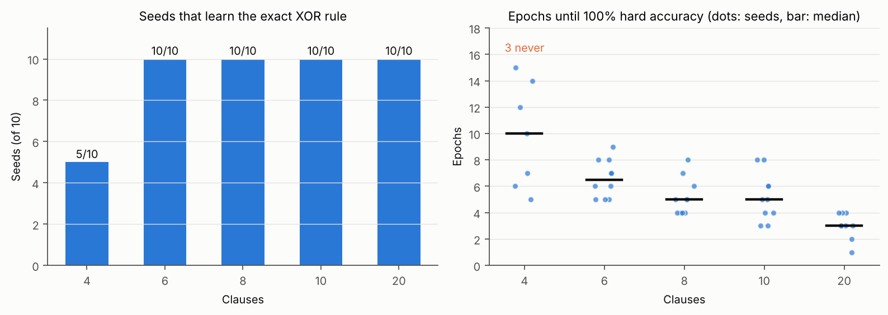
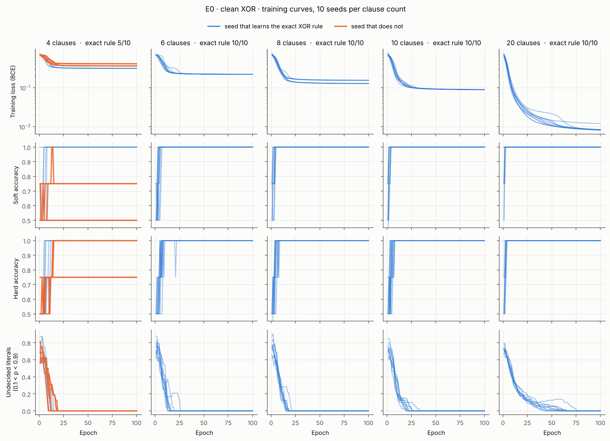
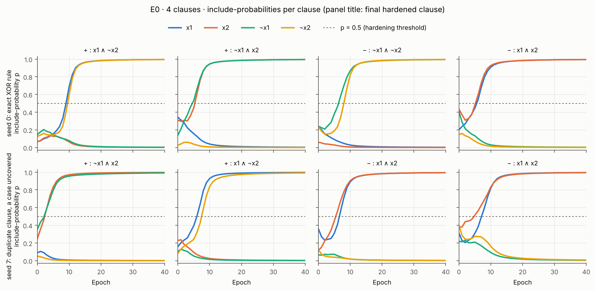

# E0 — Sanity check: clean 2-bit XOR

**Result:** the relaxed Tsetlin Machine learns XOR and, after hardening, recovers
the exact XOR rule in 10/10 seeds with 6, 8, 10 or 20 clauses. With the
minimum of 4 clauses it does so in only 5/10 seeds: two clauses can learn the
same case and leave another case uncovered. One spare clause per team (6
clauses) is already enough.

Run on 2026-10-19 (4, 10, 20 clauses) and 2026-11-04 (6, 8 clauses; 4, 10, 20 rerun with identical results), branch `relaxed-tm`. Raw results: [`../results/e0_clean_xor_m{4,6,8,10,20}.json`](../results/). Experiment plan: [PLAN.md](../PLAN.md).

## Question

Does the relaxed TM learn XOR at all, and does rounding it back to hard logic
give the XOR rule? This checks the model and training code before the real
benchmarks (E1–E6). It does not test generalization.

## Setup

| Part | Setting |
| --- | --- |
| Data | The 4 possible inputs (0,0), (0,1), (1,0), (1,1), each repeated 100 times: 400 examples. Labels are exact XOR, no noise. |
| Inputs | 2 bits → 4 literals: x1, x2, ¬x1, ¬x2 |
| Train / test | No separate test set: training and evaluation use the same 4 inputs |
| Model | Single-output `RelaxedTM`; half the clauses positive, half negative |
| Clauses | 4 (the minimum for XOR), 6, 8, 10, 20 |
| Output | sigmoid(s / τ), τ = 1; threshold b fixed at 0 |
| Initialization | w ~ Normal(mean −1.5, std 1), so literals start mostly excluded (p ≈ 0.18) |
| Loss | Binary cross-entropy |
| Optimizer | Adam, learning rate 0.05, mini-batches of 32 (13 updates per epoch) |
| Epochs | 100 (1,300 updates) |
| Regularization | None (no L1, no entropy penalty) |
| Seeds | 10 per clause count (seeds 0–9) |

None of these settings were tuned; they are first guesses.

**Measured on the model after the final epoch:**

- *Hard accuracy:* after rounding (literal included iff p > 0.5). A vote sum of exactly 0 counts as output 1, as in the standard TM.
- *Soft accuracy:* the smooth model before rounding (output 1 iff s ≥ 0).
- *Epochs to 100% hard:* the first epoch after which hard accuracy was 100%.
- *Exact XOR rule:* the hardened clauses are exactly `x1 ∧ ¬x2`, `¬x1 ∧ x2` (positive) and `x1 ∧ x2`, `¬x1 ∧ ¬x2` (negative). Duplicates allowed; a missing or wrong clause fails.

## Results

| Clauses | Seeds at 100% hard | Seeds with exact XOR rule | Mean hard accuracy | Epochs to 100% hard (median) |
| --- | --- | --- | --- | --- |
| 4 | 7/10 | 5/10 | 92.5% ± 7.1 | 10 (3 seeds never) |
| 6 | 10/10 | 10/10 | 100% | 6.5 |
| 8 | 10/10 | 10/10 | 100% | 5 |
| 10 | 10/10 | 10/10 | 100% | 5 |
| 20 | 10/10 | 10/10 | 100% | 3 |

Epochs to 100% hard accuracy, per seed (0–9):

| Clauses | 0 | 1 | 2 | 3 | 4 | 5 | 6 | 7 | 8 | 9 |
| --- | --- | --- | --- | --- | --- | --- | --- | --- | --- | --- |
| 4 | 7 | 12 | 15 | 6 | 5 | never | 14 | never | never | 10 |
| 6 | 5 | 5 | 9 | 6 | 6 | 7 | 5 | 8 | 8 | 7 |
| 8 | 4 | 4 | 7 | 5 | 4 | 8 | 5 | 5 | 4 | 6 |
| 10 | 4 | 3 | 5 | 6 | 5 | 8 | 6 | 4 | 3 | 8 |
| 20 | 1 | 3 | 3 | 3 | 3 | 4 | 3 | 4 | 2 | 4 |



### Training curves

Per epoch, on the training data, for every seed: loss, soft and hard accuracy,
and the share of literals still undecided (0.1 < p < 0.9). Orange lines are
seeds that do not end with the exact XOR rule.



- **Loss:** the failing 4-clause seeds level off higher (an uncovered input
  keeps its output at 0.5). With more clauses the loss ends lower, because
  more clauses vote on each case and push the output closer to 0 or 1.
- **Hard and soft accuracy:** jump to 100% within about 10 epochs whenever the run
  succeeds. Two failing 4-clause seeds still reach 100% hard accuracy through
  the tie rule (see Comments).
- **Undecided literals:** fall to zero within about 20 epochs with 4–10
  clauses; with 20 clauses a few stay undecided until epoch 40–75. Spare
  clauses get little gradient once the cases are covered, so they settle
  slowly. They still harden to an XOR clause.

### Rules

Rules learned with 4 clauses, seed 0 (exact XOR rule):

```
+ : x1 ∧ ¬x2
+ : ¬x1 ∧ x2
− : ¬x1 ∧ ¬x2
− : x1 ∧ x2
```

### Example: rules learned with 10 clauses, seed 0

```
+ : x1 ∧ ¬x2
+ : ¬x1 ∧ x2
+ : x1 ∧ ¬x2
+ : ¬x1 ∧ x2
+ : x1 ∧ ¬x2
− : ¬x1 ∧ ¬x2
− : ¬x1 ∧ ¬x2
− : ¬x1 ∧ ¬x2
− : x1 ∧ x2
− : x1 ∧ x2
```

Grouping the duplicates, this is the XOR rule with each case given a few votes:

| Clause | Polarity | Copies | Meaning |
| --- | --- | --- | --- |
| x1 ∧ ¬x2 | + | 3 | x1 on, x2 off → output 1 |
| ¬x1 ∧ x2 | + | 2 | x1 off, x2 on → output 1 |
| ¬x1 ∧ ¬x2 | − | 3 | both off → output 0 |
| x1 ∧ x2 | − | 2 | both on → output 0 |

How it classifies each input:

| Input (x1, x2) | Clauses that fire | Vote sum | Output | XOR |
| --- | --- | --- | --- | --- |
| (1, 0) | 3 × `+ x1 ∧ ¬x2` | +3 | 1 | 1 ✓ |
| (0, 1) | 2 × `+ ¬x1 ∧ x2` | +2 | 1 | 1 ✓ |
| (0, 0) | 3 × `− ¬x1 ∧ ¬x2` | −3 | 0 | 0 ✓ |
| (1, 1) | 2 × `− x1 ∧ x2` | −2 | 0 | 0 ✓ |

Gradient descent spread the 10 clauses over all four cases, 2–3 each, instead
of stacking them on one, so every case is covered. In plain words the learned
model reads: output 1 when exactly one of x1, x2 is on; output 0 when both are
off or both are on.

Clause statistics: in every run, every clause is one of the four XOR clauses —
no empty clauses, no contradictory clauses (x and ¬x together), and no
irrelevant literals; every clause has exactly 2 literals. With 6, 8, 10 and 20
clauses, the extra clauses are duplicates of the four XOR clauses, spread over
all four cases.

## Comments

**The relaxed TM works on XOR.** With enough clauses, every seed reaches 100%
hard accuracy within 9 epochs and the hardened model is exactly the XOR rule.
The soft–hard gap is 0 in those runs: training pushes every p to near 0 or 1,
so rounding changes nothing.

**With 4 clauses, a clause can duplicate another and leave a case uncovered.**
4 clauses means exactly one clause per XOR case, with no spare. In the 5 runs
without the exact rule, two clauses of the same polarity learned the same case:

| Seed | Learned clauses | Uncovered case | Hard accuracy |
| --- | --- | --- | --- |
| 2 | `+ ¬x1∧x2`, `+ ¬x1∧x2`, `− ¬x1∧¬x2`, `− x1∧x2` | (1,0) | 100% (tie broken correctly) |
| 5 | `+ x1∧¬x2`, `+ x1∧¬x2`, `− x1∧x2`, `− x1∧x2` | (0,1), (0,0) | 75% |
| 6 | `+ ¬x1∧x2`, `+ ¬x1∧x2`, `− ¬x1∧¬x2`, `− x1∧x2` | (1,0) | 100% (tie broken correctly) |
| 7 | `+ ¬x1∧x2`, `+ x1∧¬x2`, `− x1∧x2`, `− x1∧x2` | (0,0) | 75% |
| 8 | `+ ¬x1∧x2`, `+ ¬x1∧x2`, `− x1∧x2`, `− x1∧x2` | (1,0), (0,0) | 75% |

An uncovered input has vote sum 0. Since a sum of 0 counts as output 1, an
uncovered positive case (1,0) or (0,1) is still classified correctly; an
uncovered negative case (0,0) or (1,1) is not. That is why seeds 2 and 6 score
100% without having learned the full rule — "exact XOR rule" is the stricter
and more meaningful success measure.

**How this explanation was reached.** (1) The 4-clause run showed 7/10 at 100%.
(2) For the failing seeds we printed the hardened rules, the include-probabilities
and the vote sums for all four inputs: every failure had a duplicated clause, all
p near 0 or 1, and an uncovered input with vote sum 0. So it is not a rounding
problem; the soft model is stuck too. (3) If the cause is "no spare clauses",
more clauses should fix it: with 10 and 20 clauses, 10/10 seeds succeed (and, run later, with 6 and 8).

**When the duplicate forms.** The figure below follows each clause's four
include-probabilities in a successful seed (0) and a failing one (7). In both,
each clause commits to its final pair of literals early: the hardened rule no
longer changes after epoch 5–10 in seeds 0, 5, 7 and 8, while most p are still
far from 0 or 1. In seed 7, the fourth clause leans towards `x1 ∧ x2` from the
first epochs, the same case as the third clause, and no negative clause moves
towards `¬x1 ∧ ¬x2`.



The random starting values do not decide the outcome on their own: for each
seed we checked whether a clause's two highest starting p are the two literals
it ends with. That holds for about 1 clause in 4, in successful and failing
seeds alike (1.2 vs 1.4 of 4 on average). So the duplicate comes from the first
few epochs of training, not from the starting values alone.

**Why training does not escape (hypothesis, not yet tested).** The covered case
keeps being rewarded: both duplicates fire, the output is sigmoid(2) ≈ 0.88, and
cross-entropy only stops at 1.0, so it keeps strengthening both clauses on that
case. Moving one duplicate to the uncovered case would require dropping literals
already included with p ≈ 1, where the sigmoid is flat and the gradient tiny,
and would temporarily make the clause fire on wrong inputs. Every small step
makes the loss worse first: a local minimum. A standard TM avoids this with its
target T, which stops feedback to a case once it has enough votes and frees
clauses to learn other cases; cross-entropy has no such stopping point.

**To confirm** (part of E2, clause count). Followed up in [E0b](E0b_duplicate_clauses.md): the starting point of the weights and τ are the main causes; a T-like margin alone is not a fix.

- ~~Track clauses over epochs in a failing seed~~ done (figure above): the duplicate forms in the first 5–10 epochs, before p saturates.
- Add a T-like stopping point to the loss (zero loss once the vote sum is past a target margin) and check whether 4 clauses then reach 10/10.
- Run the standard TM with 4 clauses on the same data for comparison.

**More clauses also learn faster:** median 10 epochs (4 clauses), 6.5 (6), 5 (8), 5 (10), 3 (20).

## Reproduce

```bash
for m in 4 6 8 10 20; do python -m experiments.relaxed_tm.classification.run_e0 --clauses $m; done
python -m experiments.relaxed_tm.classification.plot_e0      # figures in reports/figures/
```

Seeds fix all randomness (initial weights and example order), so these
reproduce the numbers above on the same PyTorch version (2.14, CPU).
