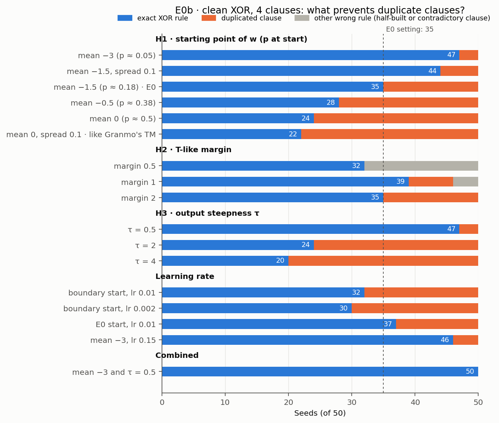

# E0b — Why do duplicate clauses form?

**Result:** with 4 clauses on clean XOR, duplicate clauses are driven by two
settings. (1) **Where the weights start:** starting at the include/exclude
boundary (p ≈ 0.5), as Granmo's Tsetlin Machine starts its automata, roughly
doubles the failures; starting far on the exclude side (p ≈ 0.05) almost
removes them. (2) **The output steepness τ:** a small τ (0.5) almost removes
them, a large τ (4) more than doubles them. Combining the two best settings
(start at w mean −3, τ = 0.5) gives the exact XOR rule in **50 of 50 seeds**.

Run on 2026-11-05, branch `relaxed-tm`. Raw results:
[`../results/e0b_{init,margin,tau,speed,followup}_m4.json`](../results/).
Follows up on [E0](E0_clean_xor.md), "Comments".

## Question

In E0, with the minimum of 4 clauses, some seeds end with two clauses of the
same team on the same XOR case and another case uncovered. What causes this,
and what prevents it? First hypothesis (H1): the starting values of the
weights; would starting at the include/exclude boundary, as Granmo's TM does,
avoid it?

## Setup

As in E0, except what each test varies:

| Part | Setting |
| --- | --- |
| Data | Clean 2-bit XOR, the 4 inputs repeated 100 times (400 examples) |
| Model | Single-output `RelaxedTM`, **4 clauses** (2 positive, 2 negative) |
| Default training | w ~ Normal(mean −1.5, std 1), τ = 1, b = 0, binary cross-entropy, Adam lr 0.05, batch 32, 100 epochs |
| Seeds | **50 per setting** (seeds 0–49), instead of E0's 10, so differences are not chance |
| Measured | Seeds with the exact XOR rule; seeds with a duplicated clause; median epochs until 100% hard accuracy |

Every run that fails without a margin (H2) fails through a duplicated clause:
in those settings, "exact rule" and "duplicate" always add up to 50.



## Results

### H1 — Starting point of the weights

| Start: w mean, spread | p at start | Exact rule (of 50) | Duplicate | Median epochs to 100% |
| --- | --- | --- | --- | --- |
| −3, 1 | ≈ 0.05 | **47** | 3 | 16 |
| −1.5, 0.1 | ≈ 0.18 | 44 | 6 | 12 |
| −1.5, 1 (E0) | ≈ 0.18 | 35 | 15 | 7 |
| −0.5, 1 | ≈ 0.38 | 28 | 22 | 3 |
| 0, 1 | ≈ 0.5 | 24 | 26 | 3 |
| 0, 0.1 (like Granmo's TM) | ≈ 0.5 | **22** | 28 | 3 |

The closer the start is to the boundary, the more duplicates, though learning
is faster. Starting at the boundary as Granmo's TM does is the **worst**
setting tested, so H1 holds in the opposite direction to the one proposed.

E0 reported 5 of 10 exact for its setting; over 50 seeds the same setting
gives 35 of 50. E0's 10 seeds were an unlucky draw.

### H2 — A T-like margin

The loss ignores an example once its vote sum is at least the margin on the
correct side, as the standard TM stops feedback at its target T
(`TrainConfig.margin`).

| Margin | Exact rule (of 50) | Duplicate | Other wrong rule |
| --- | --- | --- | --- |
| none (E0) | 35 | 15 | 0 |
| 0.5 | 32 | **0** | 18 |
| 1 | **39** | 7 | 4 |
| 2 | 35 | 15 | 0 |

A margin does reduce duplicates, but creates a new failure: the loss stops
before a clause is finished. With margin 0.5, clauses stay half-built, e.g.
`+ : x2` instead of `+ : ¬x1 ∧ x2`; with margin 1, a few end contradictory,
e.g. `x1 ∧ x2 ∧ ¬x2`, because nothing pushes the extra literal out again. A
margin of 2 is never reached without a duplicate (each team has 2 clauses),
so it changes nothing.

### H3 — Output steepness τ

| τ | Output when one clause covers a case | Exact rule (of 50) | Duplicate |
| --- | --- | --- | --- |
| 0.5 | sigmoid(2) = 0.88 | **47** | 3 |
| 1 (E0) | sigmoid(1) = 0.73 | 35 | 15 |
| 2 | sigmoid(0.5) = 0.62 | 24 | 26 |
| 4 | sigmoid(0.25) = 0.56 | **20** | 30 |

With a large τ, one covering clause leaves the output far from 1, so the
loss keeps pulling more clauses onto that case; with 4 clauses there is none
to spare. With a small τ, one clause is already "enough", and the other
clauses are free to cover the other cases. τ acts as a soft version of the
TM's target T.

### Learning rate, and the combination

| Start | Learning rate | Epochs | Exact rule (of 50) | Duplicate | Median epochs to 100% |
| --- | --- | --- | --- | --- | --- |
| boundary (0, 0.1) | 0.05 | 300 | 22 | 28 | 3 |
| boundary (0, 0.1) | 0.01 | 300 | 32 | 18 | 11 |
| boundary (0, 0.1) | 0.002 | 300 | 30 | 20 | 29 |
| E0 (−1.5, 1) | 0.01 | 300 | 37 | 13 | 28 |
| −3, 1 | 0.15 | 100 | 46 | 4 | 7 |
| **−3, 1, with τ = 0.5** | 0.05 | 100 | **50** | **0** | 16 |

## Why does the starting point matter? Explanations tested

| Explanation | Test | Verdict |
| --- | --- | --- |
| **Fast commitment.** Near the boundary, clauses lock onto a case within a few epochs, before other clauses have covered anything | A smaller learning rate should rescue the boundary start | **Partly:** 22 → 30–32 of 50, far from the 47 of a far start |
| **Random pre-commitment.** At p ≈ 0.5 each clause is already a random half-built rule and keeps the case its start favours | A clause's two highest starting p should predict its final literals more often at the boundary | **Rejected:** about a third of clauses at every start (32–38%; chance 17%) |
| **Steps to cross 0.** A far start makes each weight need many consistent steps before it is included | A larger learning rate should bring duplicates back at a far start | **Rejected:** start −3 with 3× the learning rate still gives 46 of 50 |
| **General-to-specific.** A clause started mostly excluded is nearly empty and fires on every input. Clauses specialize one after another, and a still-general clause gets pulled to whatever case is left uncovered. From the boundary, all clauses specialize at once | Clauses should settle at more different times from a far start | **Consistent, not proven:** from −3 the first clause settles at epoch 11 and the last ≈ 6 epochs later; from the boundary at epoch 1 and within ≈ 3 epochs. But the E0 start (−1.5) settles almost as staggered (≈ 5 epochs) and still fails much more often than −3 |

The general-to-specific explanation is the best current one; it fits all
results, but the direct evidence for it is weak.

## Comments

**H1 holds, in the opposite direction.** The starting point is one of the two
main causes, but starting at the boundary makes duplicates more common, not
less. Starting far on the exclude side works best.

**Implication for Granmo's TM.** His automata start at the boundary and still
learn XOR with few clauses. The TM's dynamics differ (stochastic Type I and
II feedback, target T), so this result is about the relaxed TM only.

**Implications for E1 (noisy XOR), to check in its tuning pass:**

- Try starts further on the exclude side than E0's −1.5. With 12 input bits a
  far start is still usable: at p ≈ 0.05 a clause starts at about 0.95¹² ≈ 0.54.
- Try small τ. τ = 0.5 was best here, but with 40% wrong labels and more
  clauses, a larger τ (more votes per case) may be needed for robustness, so
  the earlier grid (1, 3, 5, 15) should be extended downwards.
- A margin on its own is not a fix; skip it unless combined with something
  that finishes the clauses.
- With 20 clauses, duplicates are expected anyway (E0: 10/10 exact from 6
  clauses on). They matter here because 4 clauses leave no spare.

**Caveats.** Clean 2-bit XOR and 4 clauses only; one optimizer (Adam); 50
seeds per setting, so differences of 3–4 seeds are within chance (e.g. 44 vs
47, 30 vs 32).

## Recommendations

How to deal with duplicate clauses, based on these results. Not yet applied
anywhere; to be decided and checked in E1.

1. **Start far on the exclude side and use a small τ, after checking both on
   noisy XOR.** Start w at mean −3 (p ≈ 0.05) and use τ = 0.5: on clean XOR
   with 4 clauses this raises the exact rule from 35 to 50 of 50 seeds, at no
   cost in model size or readability. The price is slower learning (median 16
   instead of 7 epochs). Neither value should be fixed blindly:
   - τ may need to be larger with label noise: requiring several votes per
     case may protect against noisy examples. Choose τ on E1's validation
     split, with 0.5 and 1 added below the planned 3, 5 and 15.
   - The far start should carry over (with 12 input bits a clause still starts
     at ≈ 0.54), but include it in the same tuning grid alongside −1.5.
2. **Do not treat duplicates as a problem when there are enough clauses.**
   Duplicates only cost accuracy when no clause is spare: from 6 clauses on,
   E0 already gives 10 of 10 seeds with the exact rule, and E1 uses 20. There,
   a duplicate is an extra vote for the same case, as in the standard TM,
   which also keeps several copies of the XOR clauses (E1, part 1).
3. **Merge duplicates when printing rules.** Clauses that are identical after
   hardening can be shown as one rule with a count, e.g.
   `+ : x1 ∧ ¬x2  (×3)`. The model is unchanged; the printed rules become as
   short as the logic really is.

Not recommended:

- **A T-like margin on its own:** it trades duplicates for half-built or
  contradictory clauses (H2).
- **A dedicated anti-duplicate mechanism for now**, such as a penalty on
  clauses of the same team being too similar. Only worth building if
  duplicates turn out to hurt on noisy XOR or Iris.

Next steps: extend the E1 tuning grid to start ∈ {−3, −1.5} and
τ ∈ {0.5, 1, 3, 5, 15}; add duplicate merging to the rule printer.

## Reproduce

```bash
python -m experiments.relaxed_tm.classification.run_e0b_duplicates --hypothesis init
python -m experiments.relaxed_tm.classification.run_e0b_duplicates --hypothesis margin
python -m experiments.relaxed_tm.classification.run_e0b_duplicates --hypothesis tau
python -m experiments.relaxed_tm.classification.run_e0b_duplicates --hypothesis speed
python -m experiments.relaxed_tm.classification.run_e0b_duplicates --hypothesis followup
python -m experiments.relaxed_tm.classification.plot_e0b
```

Each takes 1–4 minutes on 4 cores. The two analyses in the "Explanations
tested" table (starting literals vs. final literals; when clauses settle)
were run as one-off checks and are not part of these scripts.
