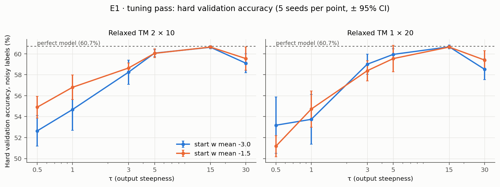
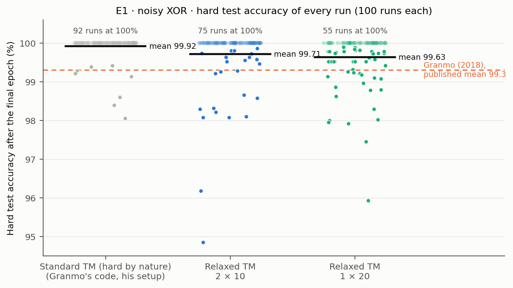
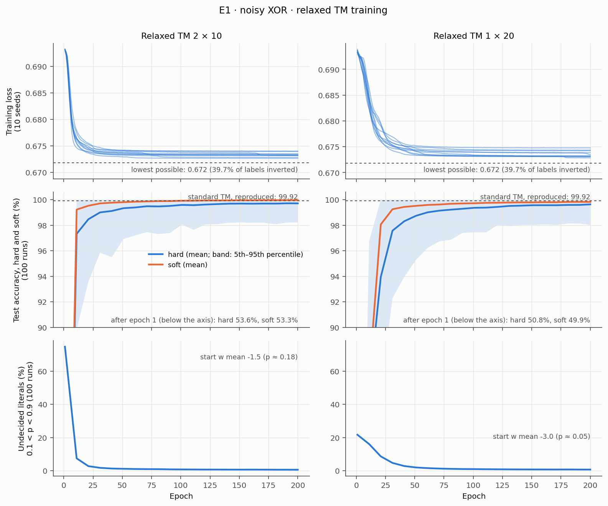

# E1 — Main result: noisy XOR

E1 has two parts: (1) reproduce Granmo's (2018) standard Tsetlin Machine
result by running his original code in his own setup, as the reference;
(2) run the relaxed TM under the same protocol. This report covers both parts.

Experiment plan: [PLAN.md](../PLAN.md), sections 2, 4 and 8.

## Part 1: Standard TM (reference)

**Result:** running Granmo's original code and noisy XOR demo, unchanged, 100
times gives **99.92% ± 0.06** mean hard test accuracy, against **99.3% ± 0.3**
published in his Table 15. (A standard TM is a hard model: its automata only
include or exclude, so all its accuracies in this report are hard accuracies.) Our reproduction is slightly better and much more
consistent: our worst run reaches 98.06%, his 91.6%.

Run on 2026-11-05, branch `relaxed-tm`. Raw results:
[`../results/e1_granmo2018_demo_noisy_xor.json`](../results/e1_granmo2018_demo_noisy_xor.json).

### Question

Does Granmo's own code, run his way on his data, reproduce his published
noisy XOR result? This sets the reference the relaxed TM is compared with.

### Setup

| Part | Granmo (2018) | Our run |
| --- | --- | --- |
| Data | 10,000 examples, 12 binary inputs; y = XOR of two inputs (x1, x2 in the released files), the other 10 random. Released as files in `cair/TsetlinMachine` | Same (his released files, unchanged since April 2018) |
| Train / test split | 50% for training: 5,000 / 5,000, the fixed split of the released files | Same |
| Label noise | 40% of outputs inverted; test outputs unperturbed | Same (39.7% of training labels inverted in the file; test labels clean) |
| TM | Multi-Class Tsetlin Machine (Section 6.1; footnote 7) | Same |
| Clauses | 20; his code splits them over the 2 classes: 10 per class, 5 positive and 5 negative | Same |
| s, T | s = 3.9, T = 15 | Same |
| Boosted true-positive feedback | Not used (footnote 7 does not mention it, unlike the Iris, digits and MNIST experiments) | Same (off) |
| Tsetlin Automaton states | "Each has 100 states"; his code uses 100 per action, 200 in total | Same |
| Epochs | 200; (hard) accuracy after the final epoch is reported | Same |
| Runs | 100 replications with different random number streams | Same: 100 fresh processes, each running his demo once, with no seeding by us |
| Code | His `MultiClassTsetlinMachine.pyx` and `NoisyXORDemo.py` (`cair/TsetlinMachine`) | Same files, commit `3cb8c89`. Changes needed for Python 3 only: `print(...)` syntax in the demo and the Cython setting `language_level=2` (see [`../granmo2018/`](../granmo2018/)) |
| Reported statistics | Test accuracy (hard): mean ± 95% CI, 5th / 95th percentile, min, max | Same, plus hard training accuracy |

His code has changed since 2018, but every change after June 2018 leaves its
behaviour the same. The one earlier change (June 5, 2018) concerns empty
clauses: before it, an empty clause voted at prediction; since then it does
not. We ran the current version.

### Results

| Measure | Granmo (2018), published (Table 15) | Our reproduction |
| --- | --- | --- |
| Runs | 100 | 100 |
| Test accuracy (hard), mean ± 95% CI | 99.3% ± 0.3 | **99.92% ± 0.06** |
| 5th / 95th percentile | 95.9 / 100.0 | 99.28 / 100.00 |
| Min / max | 91.6 / 100.0 | 98.06 / 100.00 |
| Runs ≥ 99% | — | 97 / 100 |
| Training accuracy (hard), mean | — | 60.29% |

92 of the 100 runs reach 100% hard test accuracy; the other 8 lie between 98.06%
and 99.42%.

Hard training accuracy is about 60% in every run. That is expected: with 40% of
training labels inverted, a model that has learned XOR exactly agrees with
only the 60% of labels that were not inverted.

### Comments

**The reproduction differs a bit from the published result.** The mean is
0.6 percentage points higher, and the spread is much smaller: his worst 5% of
runs fall below 95.9% and his worst run reaches 91.6%, while ours stay above
99.28% and 98.06%. A possible reason, not tested: the paper first appeared in
April 2018, when empty clauses still voted at prediction (see Setup). An empty
clause fires on every input, and with only 10 clauses per class it can tip
close votes, which would cause occasional bad runs like his. For the relaxed
TM, the reference is our reproduction (99.92%), which uses the same data and
statistics as part 2 will.

**Decision needed for part 2.** Granmo's "20 clauses" are a 2-class
Multi-Class TM (2 × 10), while the plan's E1 uses a single-output relaxed TM
with 20 clauses. Both have 20 clauses, but the structure differs. Options:

- run the relaxed TM as a 2-class `MultiClassRelaxedTM` with 10 clauses per class: the same structure as the reference, so the cleanest comparison;
- run it as a single-output `RelaxedTM` with 20 clauses, as planned, and note the difference;
- run both.

### Reproduce

```bash
pip install cython   # compiles his .pyx on first use (needs a C compiler)
python -m experiments.relaxed_tm.classification.granmo2018.repeat_demo --runs 100
```

Runs are not seeded, as in his setup, so the numbers vary slightly from one
repetition of the 100 runs to the next. His C random-number generator
(`rand()`) also differs between operating systems; our runs used Linux.

## Part 2: Relaxed TM

**Result:** the relaxed Tsetlin Machine, trained by gradient descent and then
rounded to an ordinary 0/1 Tsetlin Machine, reaches **99.71% ± 0.15** mean
hard test accuracy as 2 classes × 10 clauses and **99.63% ± 0.13** as one bank of
20 clauses: above Granmo's published 99.3% ± 0.3, slightly below our
reproduction of his standard TM (99.92% ± 0.06). Rounding costs only 0.2–0.25
percentage points. Both find the XOR clauses in almost every run, but like the
standard TM they keep a few clauses with noise bits (4.5–5.5 per run).

Run on 2026-11-05, branch `relaxed-tm`. Raw results:
[`../results/e1_relaxed_final_{2x10,1x20}.json`](../results/) (final runs),
[`../results/e1_relaxed_tune_{2x10,1x20}.json`](../results/) (tuning pass).

### Question

Does the relaxed TM, under the same data and protocol as part 1, reach the
standard TM's accuracy? How much accuracy does rounding to hard logic cost,
and are the learned clauses the XOR rule?

### Setup

| Part | Setting |
| --- | --- |
| Data, split, noise | As in part 1: Granmo's files, 5,000 training examples (39.7% of labels inverted), 5,000 clean test examples |
| Model, 2 × 10 | `MultiClassRelaxedTM`: one bank of 10 clauses (5 positive, 5 negative) per class, as Granmo's Multi-Class TM; softmax cross-entropy over the two vote sums; prediction: class with the larger hard vote sum |
| Model, 1 × 20 | `RelaxedTM`: one bank of 20 clauses (10 positive, 10 negative); binary cross-entropy; prediction: 1 if the hard vote sum ≥ 0 |
| Clauses | Soft AND over 24 literals (12 bits and their negations), include-probability p = sigmoid(w) per clause and literal ([PLAN.md](../PLAN.md), section 3) |
| Output | sigmoid((s − b) / τ), b = 0 (fixed); τ chosen in the tuning pass |
| Start | w ~ Normal(mean, std 1); mean chosen in the tuning pass |
| Optimizer | Adam, learning rate 0.05 (not tuned), mini-batches of 128 |
| Regularization | None (no L1 or entropy penalty) |
| Epochs, runs | 200 epochs, hard test accuracy after the final epoch; 100 seeds (0–99) per structure |
| Hardening | Literal included iff p > 0.5; empty clauses do not vote |
| Reported | Hard test accuracy (the result) with Granmo's statistics; soft accuracy and the soft–hard gap; clause measures as in `xor_rules.py` |

**Tuning pass.** τ and the start were chosen on a validation split, never on
the test set: 1,000 of the 5,000 training examples were held out (one fixed
random split), the model trained on the other 4,000, 5 seeds per setting.
Grid: start w mean ∈ {−3, −1.5} × τ ∈ {0.5, 1, 3, 5, 15, 30}. The validation
labels carry the same noise, so a perfect model scores only about 60.7% on
them (the share of validation labels that were not inverted); a higher hard
accuracy on clean labels still means a higher noisy score, so the ranking of settings is
unaffected. For each structure, the setting with the highest mean hard
validation accuracy was used for the final runs.

### Tuning results

Mean hard validation accuracy (noisy labels; perfect model ≈ 60.7%), 5 seeds each:

| τ | 2 × 10, start −3 | 2 × 10, start −1.5 | 1 × 20, start −3 | 1 × 20, start −1.5 |
| --- | --- | --- | --- | --- |
| 0.5 | 52.64 | 54.90 | 53.18 | 51.18 |
| 1 | 54.68 | 56.80 | 53.74 | 54.72 |
| 3 | 58.24 | 58.64 | 59.00 | 58.38 |
| 5 | 60.06 | 60.04 | 59.94 | 59.54 |
| **15** | 60.62 | **60.64** | **60.66** | 60.64 |
| 30 | 59.10 | 59.54 | 58.52 | 59.40 |



τ = 15 is clearly best for both structures; the start barely matters there
(differences of 0.02 points, far below the spread between seeds). Chosen:
**2 × 10: start −1.5, τ = 15; 1 × 20: start −3, τ = 15.**

### Results

| Measure | Granmo (2018), published | Standard TM, our reproduction (part 1) | Relaxed TM 2 × 10 | Relaxed TM 1 × 20 |
| --- | --- | --- | --- | --- |
| Runs | 100 | 100 | 100 | 100 |
| Test accuracy (hard), mean ± 95% CI | 99.3 ± 0.3 | 99.92 ± 0.06 | **99.71 ± 0.15** | **99.63 ± 0.13** |
| 5th / 95th percentile | 95.9 / 100.0 | 99.28 / 100.00 | 98.21 / 100.00 | 98.02 / 100.00 |
| Min / max | 91.6 / 100.0 | 98.06 / 100.00 | 94.86 / 100.00 | 95.94 / 100.00 |
| Runs at 100% / ≥ 99% | — | 92 / 97 | 75 / 90 | 55 / 88 |
| Soft test accuracy, mean | — | — | 99.96 | 99.83 |
| Soft–hard gap, mean | — | — | 0.25 pp | 0.19 pp |
| Training accuracy (hard), mean | — | 60.29% | 60.31% | 60.35% |
| Training time per run | — | — | ≈ 6 s | ≈ 4 s |

Training time: on the Mac (CPU, 4 runs in parallel). Hard training accuracy is
about 60% for every model, because 39.7% of the training labels are inverted
(see part 1).



### Training curves



- **Learning is fast.** 2 × 10 reaches 97.3% hard and 99.2% soft test
  accuracy after 11 epochs; 1 × 20 is slower (hard / soft: 85.0% / 86.1% after
  11 epochs, 97.6% / 99.3% after 31). After that, the hard accuracy keeps rising slowly
  until the last epoch (2 × 10: 99.33% after 51 epochs, 99.59% after 101,
  99.71% after 200).
- **The training loss reaches the noise floor.** With 39.7% of the labels
  inverted, no model can get the loss below 0.672 (the entropy of the label
  noise). Both structures end within about 0.002 of it: they fit everything
  except the noise.
- **Soft is ahead of hard during training**, and the gap closes as the
  literals decide: the share of undecided literals (0.1 < p < 0.9) falls to
  0.6–0.7% by the end. (Its level in the first epochs reflects the start:
  p ≈ 0.18 counts as undecided, p ≈ 0.05 does not.)

The loss curves come from re-running seeds 0–9 of each structure in the
sandbox, because the final runs did not record the loss; the re-runs end at
exactly the recorded hard test accuracy in 10 of 10 seeds for both structures
(results in `e1_relaxed_loss_{2x10,1x20}.json`). The hard and soft accuracy
curves and the undecided curve are from all 100 final runs.

### Learned clauses

| Measure | Relaxed TM 2 × 10 | Relaxed TM 1 × 20 |
| --- | --- | --- |
| XOR clauses present (at least one bank) | 92 / 100 runs | 100 / 100 runs |
| XOR clauses present in both banks | 61 / 100 runs | (one bank only) |
| Exact XOR rule, no extra clauses | 0 / 100 | 0 / 100 |
| Clauses using a noise bit, mean per run | 4.5 (of 20) | 5.5 (of 20) |
| Runs where no clause uses a noise bit | 0 / 100 | 0 / 100 |
| Empty / contradictory clauses (all runs) | 0 / 0 | 0 / 0 |
| Mean clause length | 2.19 literals | 2.21 literals |

For comparison, Granmo's original code run in our own harness (100 seeded
runs, the same algorithm as part 1; kept in
`../results/e1_granmo2018_tm_noisy_xor.json`, not reported in part 1)
keeps 4.4 noise-bit clauses per run, with the XOR clauses in at least one
bank in 98 runs and in both banks in 81. Every clause that is not an XOR
clause contains a noise bit, in both relaxed structures.

Example, 2 × 10, seed 0, "y = 1" bank (100% hard test accuracy):

```
+ : x1 ∧ ¬x2
+ : x3 ∧ x8 ∧ x11     ← noise bits only
+ : ¬x1 ∧ x2
+ : ¬x1 ∧ x2
+ : ¬x1 ∧ x2
− : x1 ∧ x2
− : x1 ∧ x2
− : x1 ∧ x2
− : x1 ∧ x2
− : ¬x1 ∧ ¬x2
```

Example, 1 × 20, seed 0 (100% hard test accuracy), duplicates merged:

```
+ : x1 ∧ ¬x2            (×2)
+ : ¬x1 ∧ x2            (×5)
+ : x6 ∧ x8 ∧ ¬x10      (×2)   ← noise bits only
+ : x8 ∧ x11 ∧ x12             ← noise bits only
− : x1 ∧ x2             (×5)
− : ¬x1 ∧ ¬x2           (×4)
− : ¬x1 ∧ ¬x2 ∧ ¬x11           ← XOR clause plus a noise bit
```

All rules for every run are in the JSON files (`rules`).

### The weaker runs

10 runs (2 × 10) and 12 runs (1 × 20) end below 99%. They are not missing the
XOR clauses: all of them have the four XOR clauses. Instead they keep more
noise-bit clauses (2 × 10: 6.2 per run, against 4.4 in the other runs;
1 × 20: 7.7 against 5.2), which outvote the XOR clauses on some inputs. Most
of the rounding loss also falls in these runs: their soft–hard gap is
2.0 points (2 × 10) and 0.7 points (1 × 20), against 0.1 in the other runs.

### Comments

**The relaxed TM works on noisy XOR.** Checked against the plan's success
criteria (section 9):

| Criterion | Target | 2 × 10 | 1 × 20 |
| --- | --- | --- | --- |
| Mean hard test accuracy | ≥ 98%, close to the standard TM | 99.71% ✓ | 99.63% ✓ |
| Soft–hard gap | ≤ 1 pp | 0.25 pp ✓ | 0.19 pp ✓ |
| XOR rule with x3–x12 excluded in most runs | most runs | 0 runs ✗ | 0 runs ✗ |

The third criterion is not met by the standard TM either (part 1's code keeps
4.4 noise-bit clauses per run when run in our harness), so it may be too
strict for 20 clauses on this data. It is the obvious target for the L1
penalty on p, which pushes unneeded literals out (see "Further optimization"
below).

**Slightly below the reproduced standard TM.** The difference (99.71 and
99.63 against 99.92) comes from the weaker runs: the relaxed TMs have more
runs below 99% (10 and 12, against 3). Both are above Granmo's published
result.

**2 × 10 or 1 × 20.** Equal within noise on hard test accuracy (99.71 ± 0.15 and
99.63 ± 0.13). 2 × 10 learns faster; 1 × 20 has a slightly smaller mean
soft–hard gap (0.19 against 0.25 pp) and finds the XOR clauses in every run
(in 2 × 10, one bank can miss a clause that the other bank covers, as in the
standard TM).

**τ matters most, and in the opposite direction to clean XOR.** On clean
XOR with 4 clauses, a small τ (0.5) prevented duplicate clauses
([E0b](E0b_duplicate_clauses.md)); with 40% wrong labels, a small τ is close
to guessing and τ = 15 is best. A large τ means each case needs many votes
before training eases off, which protects against noisy examples: the role
of Granmo's target T, which is also 15 for this experiment.

**Limitations.** Learning rate and batch size were not tuned; 5 seeds per
tuning point; no regularization yet. The final runs ran on the Mac, the loss
re-runs in the Linux sandbox, with identical results where they overlap.

**Next.** Noisy XOR was an extra check of our own, not a task the
supervisor asked for. The relaxed TM already meets the accuracy and
soft–hard gap criteria, so we stop optimizing it here and move on to Iris
(E4). The planned noisy-XOR experiments E2 (clause count), E3 (noise level)
and E5 (ablations) are skipped.

### Further optimization (not pursued)

Ideas for improving the relaxed TM on noisy XOR, should it be needed later.
None of them has been tested.

1. **L1 penalty on the include-probabilities.** Add λ₁ · Σ p to the loss, so
   that every included literal has a cost. A literal that does not help
   (a noise bit) should then be pushed out. This is the most direct fix for
   the criterion we missed: every run keeps 4.5–5.5 clauses with noise bits.
   λ₁ has to be small, or real XOR literals get pushed out too.
2. **Push the p values to 0 or 1 before rounding.** Most of the rounding
   loss is in the weaker runs (gap of 2.0 points in 2 × 10, against 0.1 in
   the other runs). Two ways to do it: an entropy penalty that punishes p
   values near 0.5, or lowering the "temperature" of the sigmoid in p
   during training so that p becomes steeper over time. Either way, the
   soft model would already be close to the hard one before rounding.
3. **Prune clauses after hardening.** Remove one clause at a time and keep
   the removal if validation accuracy does not drop. This needs no
   retraining and would shorten the printed rules. Duplicate clauses can
   also be merged into one rule with a count (E0b recommendation 3).
4. **Tune learning rate and batch size.** Both were fixed (0.05 and 128).
   A lower learning rate or larger batches give a smoother gradient on
   noisy labels, which may reduce the number of weaker runs.
5. **Choose among several seeds on validation.** About 10 of 100 runs end
   below 99%. Training a few seeds and keeping the one with the best
   validation accuracy would very likely avoid them, at the cost of extra
   training time. This is a deployment trick, not a fix to the method, and
   it would make the comparison with Granmo's per-run statistics unfair.
6. **Open questions we did not test.** How few clauses are enough (planned
   E2), and how accuracy changes with less or more label noise compared with
   the standard TM (planned E3).

### Reproduce

```bash
# tuning pass (runs can be split with --tune-init-means / --tune-taus; results are merged)
python -m experiments.relaxed_tm.classification.run_e1_relaxed --structure 2x10 --mode tune --tune-taus 0.5 1 3 5 15 30
python -m experiments.relaxed_tm.classification.run_e1_relaxed --structure 1x20 --mode tune --tune-taus 0.5 1 3 5 15 30
# final runs (about 10 minutes each with 4 workers)
python -m experiments.relaxed_tm.classification.run_e1_relaxed --structure 2x10 --mode final --init-mean -1.5 --tau 15
python -m experiments.relaxed_tm.classification.run_e1_relaxed --structure 1x20 --mode final --init-mean -3 --tau 15
# figures (re-runs seeds 0-9 for the loss curves on first use)
python -m experiments.relaxed_tm.classification.plot_e1
```
