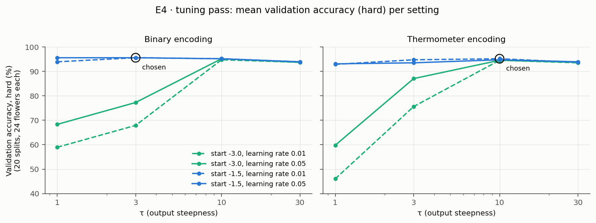
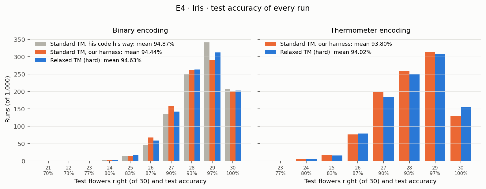
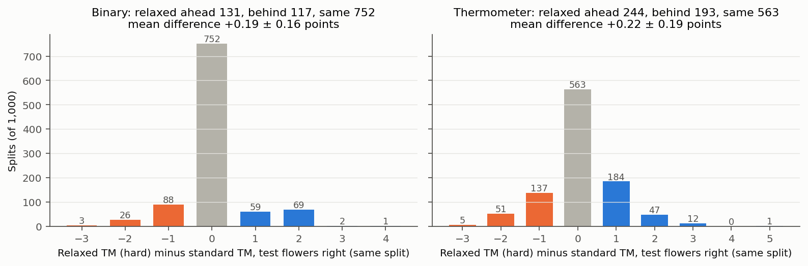
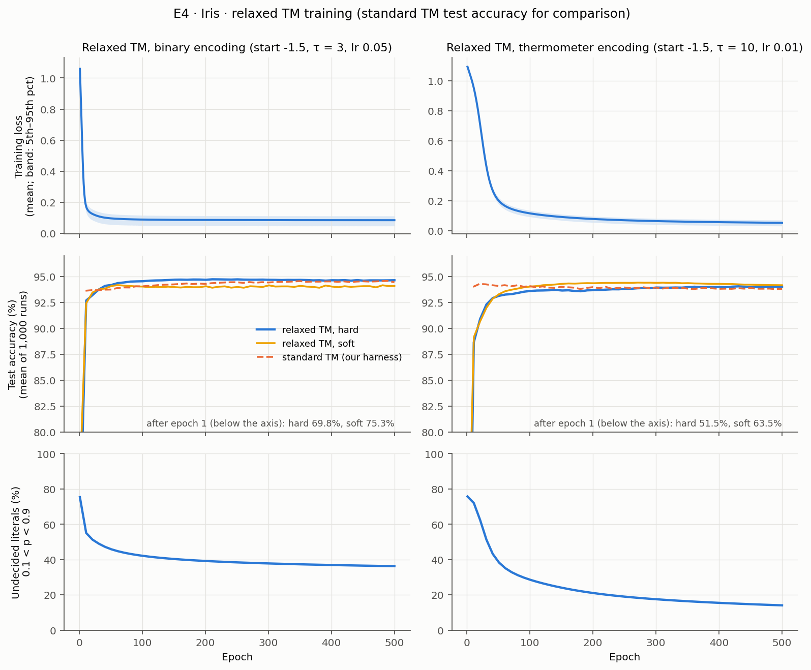
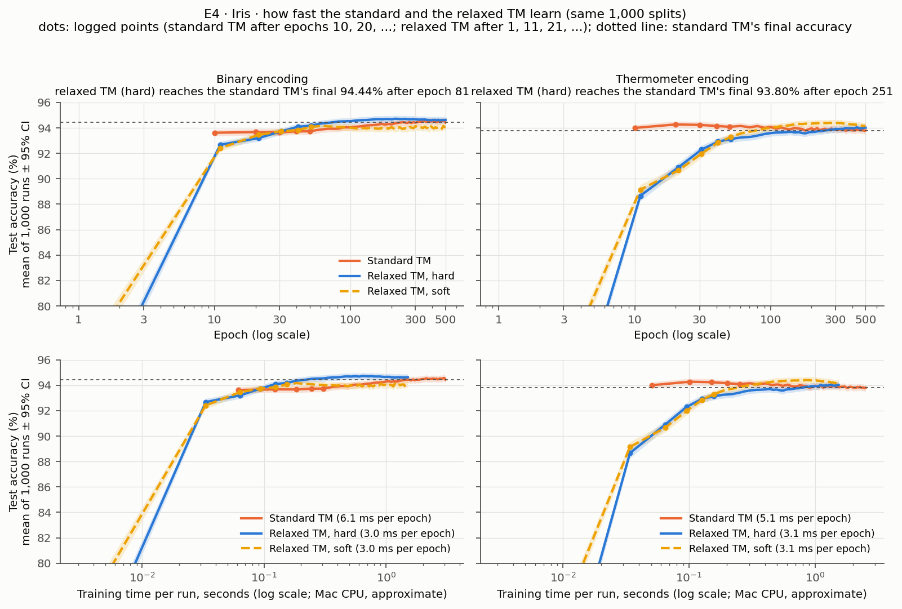

# E4 — Main result: Iris

E4 has three parts: (1) reproduce Granmo's (2018) Binary Iris result by
running his original code in his own setup, as the reference; (2) run the
relaxed TM on the same data and protocol, and compare it with the standard TM
on identical splits; (3) repeat both with thermometer encoding, which gives
readable rules.

Experiment plan: [PLAN.md](../PLAN.md), sections 2, 4 and 8. Run on
2026-11-06 on the Mac (all steps with one command, `run_e4_all.sh`,
1 h 25 min), branch `relaxed-tm`.

**Result:** the relaxed TM matches the standard TM on Iris. All numbers are
mean hard test accuracy over 1,000 runs ± 95% confidence interval. A standard
TM is a hard model (its automata only include or exclude), so its accuracies
are hard by nature; for the relaxed TM, hard means after rounding to 0/1
logic.

| | Granmo (2018), published | Standard TM, his code his way (part 1) | Standard TM, our harness | Relaxed TM (hard) |
| --- | --- | --- | --- | --- |
| Binary encoding (his file) | 95.0 ± 0.2 | **94.87 ± 0.26** | 94.44 ± 0.27 | **94.63 ± 0.26** |
| Thermometer encoding | — | — | 93.80 ± 0.26 | **94.02 ± 0.26** |

- **Part 1:** his code, run his way, reproduces his published result.
- **Part 2:** on the same 1,000 splits, the relaxed TM scores +0.19 ± 0.16
points higher than the standard TM: the same score on 752 splits, ahead on
131, behind on 117. Effectively equal, with a very slight edge.
- **Part 3:** thermometer encoding costs both models about 0.6 points, and the
relaxed TM is again level (+0.22 ± 0.19). Its rules are much more compact
than the standard TM's: about 21 distinct rules per class against 67, each
readable as intervals on the measurements.

## Shared setup

| Part | Setting |
| --- | --- |
| Data | Iris: 150 flowers, 4 measurements (sepal length and width, petal length and width), 3 species with 50 flowers each |
| Split | Random 80/20 per run: 120 training flowers, 30 test flowers; a new split for every run |
| Runs | 1,000 per model and encoding; test accuracy after the final epoch (no picking of the best epoch) |
| Statistics | As Granmo's Table 6: mean ± 95% CI (1.96 · std / √n), 5th/95th percentile, min, max |

With 30 test flowers, one flower is worth 3.33 points, so a single run can
only score 100%, 96.7%, 93.3%, ...; the 1,000 runs are what make the mean
precise.

**The two encodings** (16 bits each, so the models have the same size):

| Encoding | How | Example: a setosa flower |
| --- | --- | --- |
| Binary (Granmo's file) | Each measurement binned into a small number (0–3) and written as a 4-bit binary number, most significant bit first. Bin edges not documented | `0011 0010 0000 0000` = bins 3, 2, 0, 0 |
| Thermometer | 4 thresholds per measurement at the 20/40/60/80% quantiles of the training flowers (computed per split, never on the test flowers); one bit per threshold: "value > threshold?" | sepal length 5.1, sepal width 3.5, petal length 1.4, petal width 0.2 → `1000 1111 0000 0000` |

A thermometer bit has a meaning of its own ("petal length > 4.64"); a bit
of Granmo's binary numbers does not ("the last bit of petal length's bin
number is 1" means "the bin is 1 or 3"). In Granmo's file, **7 of the 16 bits
are 0 for every flower**, because the bins never reach 4: the first bit of
each number, and also the second bit of sepal width and the second and third
bits of petal width.

## Part 1: Standard TM, Granmo's code his way (reference)

### Question

Does Granmo's own code, run his way on his data, reproduce his published
Binary Iris result?

### Setup

| Part | Granmo (2018) | Our run |
| --- | --- | --- |
| Code | `MultiClassTsetlinMachine.pyx` and `BinaryIrisDemo.py` (`cair/TsetlinMachine`) | The versions he uploaded on 21 April 2018 (`MultiClassTsetlinMachine.pyx` at commit `b9a1491`, `BinaryIrisDemo.py` at `5678644`), in [`../granmo2018/april2018/`](../granmo2018/april2018/). Changes: Python 3 syntax, the Cython setting `language_level=2`, and one added print line with each ensemble's own accuracy (his script prints only running averages) |
| Data | Binary Iris file, 16 bits | Same file |
| Model | Multi-Class TM, 300 clauses (3 classes × 100), T = 10, s = 3.0, 100 states per action, `boost_true_positive_feedback = 1` | Same (his script, unchanged) |
| Training | 500 epochs, 1,000 ensembles (each a new random 80/20 split and a new TM), one process, no seeding | Same |

**Why the April 2018 version, not the one used for E1.** His Iris demo passes
`boost_true_positive_feedback = 1`, an option that later versions of
`MultiClassTsetlinMachine.pyx` (including the one used for E1, noisy XOR)
no longer have. The version uploaded on the same day as the demo has it.

### Results

| Measure | Granmo (2018), Table 6 | Our reproduction |
| --- | --- | --- |
| Test accuracy, mean ± 95% CI | 95.0 ± 0.2 | **94.87 ± 0.26** |
| 5th / 95th percentile | 86.7 / 100.0 | 86.7 / 100.0 |
| Min / max | 80.0 / 100.0 | 70.0 / 100.0 |
| Training accuracy, mean | — | 96.62% |
| Wall time | — | 46 min (one process, Mac CPU) |

**Reproduced.** The mean is within the uncertainty of the published one, and
the percentiles are identical. Our worst run is lower (70.0% against 80.0%):
with 1,000 random splits, a single unlucky split decides the minimum.

For context, the other methods in his Table 6: multilayer perceptron 93.8 ±
0.2, SVM 93.6 ± 0.3, logistic regression 92.6 ± 0.2, naive Bayes 91.6 ± 0.3.

Raw results: [`../results/e4_granmo2018_demo_binary_iris.json`](../results/e4_granmo2018_demo_binary_iris.json).

## Part 2: Relaxed TM, binary encoding

### Question

On Granmo's data and protocol, does the relaxed TM, rounded to hard logic,
reach the standard TM's accuracy? And on the same splits, which of the two
does better?

### Setup

| Part | Setting |
| --- | --- |
| Model | `MultiClassRelaxedTM`: 3 classes × 100 clauses (50 positive, 50 negative), Granmo's 300 clauses; soft AND over 32 literals (16 bits and their negations), include-probability p = sigmoid(w) |
| Loss, prediction | Softmax cross-entropy over the class vote sums divided by τ; prediction: the class with the largest hard vote sum |
| Threshold b | 0, fixed (as in E1; PLAN.md suggested a learned b per class, not used) |
| Start | w ~ Normal(mean, std 1); mean chosen in the tuning pass |
| Optimizer | Adam, mini-batches of 32; learning rate chosen in the tuning pass |
| Regularization | None |
| Epochs, runs | 500 epochs, test accuracy after the final epoch; seeds 0–999 |
| Hardening | Literal included iff p > 0.5; empty clauses do not vote |
| Splits | Seed k uses the same 120/30 flowers as the standard TM's run k in our harness (below) |

**Standard TM, our harness.** To compare the two models on identical
splits, Granmo's April 2018 TM (same settings as part 1) was also run from
our own script (`run_e4_baseline.py`): seeded, run k on the relaxed TM's
split k. It differs from part 1 only in the splits and random numbers. It
also records the learned clauses, converted to our `HardMultiClassTM`.

**Tuning pass.** Three settings of the relaxed TM were chosen by a fixed
rule on validation data, never on the test flowers:

- **Settings tried:** the start mean of w (−3 or −1.5), τ (1, 3, 10 or 30)
  and the learning rate (0.01 or 0.05): 2 × 4 × 2 = 16 combinations.
- **Score of a combination:** for each of 20 splits, 24 of the 120 training
  flowers are held out as validation flowers, and the model trains on the
  other 96 (the 30 test flowers are not used). That gives 20 × 24 = 480
  validation predictions per combination; the score is the share of them
  that are right, with the hard model (validation accuracy, hard). A single
  split's 24 flowers would be too noisy a measure (one flower = 4.2 points),
  hence the 20 splits.
- **Rule:** take the combination with the highest validation accuracy
  (hard). Only if several combinations tie on it, take the one among them
  with the highest validation accuracy (soft). The soft accuracy is used for
  nothing else.

Each encoding is tuned separately on its own validation data, so binary and
thermometer each get their own setting (thermometer: part 3).

### Tuning results

Validation accuracy (hard, %) of all 16 combinations, binary encoding:

| τ | start −3, lr 0.01 | start −3, lr 0.05 | start −1.5, lr 0.01 | start −1.5, lr 0.05 |
| --- | --- | --- | --- | --- |
| 1 | 58.96 | 68.33 | 93.96 | 95.62 |
| 3 | 67.92 | 77.29 | 95.62 | **95.62** |
| 10 | 94.79 | 95.21 | 95.21 | 95.21 |
| 30 | 93.75 | 93.75 | 93.96 | 93.96 |



**Three combinations tie at the top**, each with 459 of the 480 validation
predictions right; the tie is broken by the soft accuracy:

| Start | τ | Learning rate | Validation, hard | Right (of 480) | Validation, soft |
| --- | --- | --- | --- | --- | --- |
| −1.5 | 1 | 0.05 | 95.62% | 459 | 94.37% |
| −1.5 | 3 | 0.01 | 95.62% | 459 | 94.79% |
| **−1.5** | **3** | **0.05** | **95.62%** | **459** | **95.00%** ← chosen |
| −1.5 | 10 | 0.05 | 95.21% | 457 | 94.79% |

**Chosen for binary: start −1.5, τ = 3, learning rate 0.05.**

- **The top combinations are practically equal.** They are within 2 of 480
  validation predictions of each other, well within the noise, so which one
  wins is close to arbitrary and any of them would very likely give the same
  test accuracy. This is also why binary and thermometer end up with
  different τ (3 and 10): there is no deeper reason behind it.
- **What the tuning does show clearly is what to avoid:** the far start (−3,
  p ≈ 0.05) combined with a small τ (1 or 3) fails (59–77% here, 46–87% on
  thermometer). With the near start (−1.5) every τ works, and with τ = 10
  both starts work. Why the far start needs a large τ was not investigated.

### Results

| Measure | Standard TM, his way (part 1) | Standard TM, our harness | Relaxed TM |
| --- | --- | --- | --- |
| Test accuracy (hard), mean ± 95% CI | 94.87 ± 0.26 | 94.44 ± 0.27 | **94.63 ± 0.26** |
| 5th / 95th percentile | 86.7 / 100.0 | 86.7 / 100.0 | 86.7 / 100.0 |
| Min / max | 70.0 / 100.0 | 73.3 / 100.0 | 73.3 / 100.0 |
| Runs at 100% | 207 | 201 | 203 |
| Test accuracy (soft), mean | — | — | 94.07 |
| Soft–hard gap, mean | — | — | −0.56 pp |
| Training accuracy (hard), mean | 96.62 | 96.65 | 96.70 |
| Training time per run (Mac, 4 runs in parallel) | — | 3.1 s | 1.5 s |



The three distributions are nearly the same. The two standard-TM columns
differ by 0.43 ± 0.37 points, about the size of run-to-run variation between
two different sets of 1,000 splits.

**Same splits: relaxed TM against standard TM (our harness).** For each
split, the relaxed TM's number of test flowers right minus the standard TM's:



| | Binary encoding |
| --- | --- |
| Same score | 752 splits |
| Relaxed TM ahead / behind | 131 / 117 splits |
| Mean difference (relaxed − standard), hard | **+0.19 ± 0.16 points** |

On three splits in four, both models get exactly the same flowers right.
The mean difference is just above zero (its interval runs from +0.03 to
+0.35): about one extra flower right in every 17 splits. The two models are
effectively equal. Comparing on the same splits removes the luck of the
split that both models share, which is why this interval (±0.16) is narrower
than either model's own (±0.26).

**Soft–hard gap.** The gap is negative: rounding makes the relaxed TM
slightly *better* on test (94.63% hard against 94.07% soft). The training
accuracies are nearly equal (96.70% hard, 96.73% soft), so rounding mainly
changes the borderline test flowers, and on average in the right direction.

### Training curves



- **Fast learning, but the standard TM is faster.** The standard TM is at
93.6% (binary) and 94.0% (thermometer) test accuracy after 10 epochs. The
relaxed TM reaches 92.7% (binary) and 88.7% (thermometer) hard test
accuracy after 11 epochs; on binary it passes the standard TM after about
30 epochs, on thermometer only after about 300.
- **Per second of training the gap is smaller.** One relaxed-TM epoch takes
  about 3 ms against 5–6 ms for the standard TM (Mac CPU, 120 flowers), so
  measured in training time the relaxed TM catches up about twice as early.
  It reaches the standard TM's *final* accuracy after epoch 81 (binary) and
  epoch 251 (thermometer):

  

- **Overfitting is slight.** The relaxed TM's test accuracy (hard) stays
flat or keeps rising slowly until epoch 500. The standard TM on
thermometer bits peaks after 20 epochs (94.27%) and then drops slowly to
93.80%: with Granmo's protocol (final epoch reported) it loses about 0.5
points to training too long.
- **Undecided literals stay high (36% at the end).** That is mostly the 7
always-0 bits: including their negation ("this bit is 0") is always true,
so it changes no clause output and gets no gradient, and its p stays near
its start (≈ 0.18, counted as undecided). These 7 negated literals make up
22% of all literals. They round to "excluded" and have no effect on
predictions.

Raw results: [`../results/e4_relaxed_tune_binary.json`](../results/e4_relaxed_tune_binary.json),
[`../results/e4_relaxed_final_binary.json`](../results/e4_relaxed_final_binary.json),
[`../results/e4_standard_tm_binary.json`](../results/e4_standard_tm_binary.json).

## Part 3: Thermometer encoding

### Question

With readable inputs, does the relaxed TM still match the standard TM, and
what does the encoding cost in accuracy?

### Setup

As part 2, with the thermometer encoding in place of Granmo's file. The
thresholds are recomputed on the training flowers of every split (in the
tuning pass, on the 96 training flowers). The standard TM uses Granmo's
settings unchanged; there is no published result for this encoding, so our
harness is the reference.

The relaxed TM was tuned again, on its own validation data, with the same 16
combinations and the same rule as in part 2.

Validation accuracy (hard, %) of all 16 combinations, thermometer encoding:

| τ | start −3, lr 0.01 | start −3, lr 0.05 | start −1.5, lr 0.01 | start −1.5, lr 0.05 |
| --- | --- | --- | --- | --- |
| 1 | 46.04 | 59.79 | 92.92 | 93.12 |
| 3 | 75.62 | 87.08 | 94.79 | 93.54 |
| 10 | 94.58 | 94.58 | **95.21** | 94.79 |
| 30 | 93.54 | 93.75 | 93.75 | 93.96 |

Here one combination wins outright, so no tie-break was needed:

| Start | τ | Learning rate | Validation, hard | Right (of 480) |
| --- | --- | --- | --- | --- |
| **−1.5** | **10** | **0.01** | **95.21%** | **457** ← chosen |
| −1.5 | 3 | 0.01 | 94.79% | 455 |
| −1.5 | 10 | 0.05 | 94.79% | 455 |

**Chosen for thermometer: start −1.5, τ = 10, learning rate 0.01.** Again the
top combinations are within 2 of 480 predictions of each other. The
tuning figure in part 2 marks the chosen setting for both encodings.

### Results

| Measure | Standard TM, our harness | Relaxed TM |
| --- | --- | --- |
| Test accuracy (hard), mean ± 95% CI | 93.80 ± 0.26 | **94.02 ± 0.26** |
| 5th / 95th percentile | 86.7 / 100.0 | 86.7 / 100.0 |
| Min / max | 76.7 / 100.0 | 80.0 / 100.0 |
| Runs at 100% | 129 | 155 |
| Test accuracy (soft), mean | — | 94.15 |
| Soft–hard gap, mean | — | +0.13 pp |
| Training accuracy (hard), mean | 98.56 | 98.26 |
| Same splits: relaxed − standard (hard) | | **+0.22 ± 0.19 points** (ahead 244, behind 193, same 563) |
| Training time per run (Mac) | 2.5 s | 1.5 s |

**The relaxed TM is again level with the standard TM**, with the same very
slight edge as on the binary encoding. The two models disagree more often
here (563 same-score splits against 752).

**Thermometer encoding costs about 0.6 points, for both models** (relaxed:
94.63 → 94.02; standard: 94.44 → 93.80). Both fit the training flowers
better with thermometer bits (training accuracy ≈ 98% against ≈ 97%) but do
slightly worse on test. A possible reason, not tested: Granmo's coarse bins
(2–4 values per measurement) smooth the data, while 4 thresholds per
measurement let the models fit individual training flowers. The readable
encoding has a small but real price; fewer thresholds (k = 2 or 3) might
remove it.

Raw results: [`../results/e4_relaxed_tune_thermometer.json`](../results/e4_relaxed_tune_thermometer.json),
[`../results/e4_relaxed_final_thermometer.json`](../results/e4_relaxed_final_thermometer.json),
[`../results/e4_standard_tm_thermometer.json`](../results/e4_standard_tm_thermometer.json).

## Learned clauses

Rules were saved for seeds 0–19 of every model; clause statistics for all
runs. Means per run, all 1,000 runs:

| Measure | Standard TM, binary | Relaxed TM, binary | Standard TM, thermometer | Relaxed TM, thermometer |
| --- | --- | --- | --- | --- |
| Empty clauses (of 300) | 20.9 | 1.2 | 14.8 | 1.4 |
| Literals per non-empty clause | 4.44 | 4.15 | 4.64 | 4.40 |

**The relaxed TM uses nearly all its clauses**; the standard TM leaves 5–7%
of them empty. Clause lengths are similar.

**Distinct rules.** Many clauses in a bank are copies of each other, so the
number of *different* clauses per class is the better measure of how much
there is to read (seeds 0–19):

| Distinct non-empty clauses per class (of 100) | Standard TM | Relaxed TM |
| --- | --- | --- |
| Binary, as learned | 53.2 | 64.7 |
| Binary, without negated always-0 bits | 48.5 | 42.8 |
| Thermometer, as learned | 70.7 | 36.2 |
| Thermometer, rewritten as intervals | **67.0** | **20.7** |

- *Binary:* 36–39% of the clauses contain a negated always-0 bit, which is
always true and changes nothing. In the relaxed TM such literals stay
undecided and some land just above p = 0.5, which makes otherwise identical
clauses look different. Without them, the relaxed TM has fewer distinct
clauses than the standard TM.
- *Thermometer:* thermometer bits are ordered ("> 6.52" implies "> 6.10"),
so each clause can be rewritten as one interval per measurement, e.g.
`¬sepal_length>6.10 ∧ ¬sepal_length>6.52` is `sepal_length ≤ 6.10`. After
that, the relaxed TM has **about 21 distinct rules per class against 67**:
it learns a few rules and repeats them, where the standard TM spreads its
votes over many slightly different clauses. Its rules use slightly more
measurements each (2.87 against 2.37).

**Example: thermometer, seed 1** (both models 29 of 30 test flowers right).
Most frequent rules per class, rewritten as intervals, with how many of the
100 clauses are that rule (+ votes for the class, − against):

Relaxed TM:

```
[setosa]      8 distinct rules
  ×36  + : sepal_width > 2.70 ∧ sepal_length ≤ 6.04 ∧ petal_length ≤ 4.00 ∧ petal_width ≤ 1.20
  ×29  − : petal_length > 1.50 ∧ petal_width > 0.28
  ×12  + : sepal_length ≤ 6.04 ∧ petal_length ≤ 4.00 ∧ petal_width ≤ 1.20
[versicolor]  30 distinct rules
  ×27  + : 1.50 < petal_length ≤ 4.64 ∧ 0.28 < petal_width ≤ 1.50 ∧ sepal_width ≤ 3.10
  ×12  + : sepal_length > 5.08 ∧ 1.50 < petal_length ≤ 5.42 ∧ 0.28 < petal_width ≤ 2.00 ∧ sepal_width ≤ 3.40
  ×9   − : sepal_width > 2.70 ∧ sepal_length ≤ 6.04 ∧ petal_length ≤ 4.00 ∧ petal_width ≤ 1.20
[virginica]   17 distinct rules
  ×27  − : petal_length ≤ 4.64 ∧ petal_width ≤ 1.50
  ×15  − : sepal_width > 2.70 ∧ petal_length ≤ 5.42 ∧ petal_width ≤ 2.00
  ×10  + : petal_length > 4.00 ∧ petal_width > 1.20
```

Standard TM:

```
[setosa]      77 distinct rules
  ×4   + : petal_width ≤ 0.28
  ×3   − : petal_width > 1.20
  ×3   − : petal_length > 4.64
[versicolor]  64 distinct rules
  ×6   − : petal_length > 5.42
  ×6   − : petal_width > 2.00
  ×5   − : petal_length ≤ 1.50
[virginica]   52 distinct rules
  ×10  − : petal_width ≤ 1.20
  ×6   + : petal_width > 2.00
  ×6   − : petal_length ≤ 4.64
```

The relaxed TM's rules describe the species directly: setosa has small
petals (length ≤ 4.00, width ≤ 1.20); versicolor has medium petals (1.50 <
length ≤ 4.64, 0.28 < width ≤ 1.50); virginica is voted against when its
petals are small and for when they are large (length > 4.00, width > 1.20).
Its three top rules per class carry 48–77 of the 100 votes. The standard TM's rules
are mostly short single-measurement conditions, but spread over 52–77
distinct clauses, so its top three carry only 10–22 votes per class.

For the binary encoding the rules cannot be read this way: a bit of a binary
number has no meaning on its own and the bin edges are not documented.

## Comments

**The relaxed TM works on Iris.** Checked against the plan's success
criteria (section 9):

| Criterion | Target | Binary | Thermometer |
| --- | --- | --- | --- |
| Mean hard test accuracy | ≥ 94%, close to the standard TM's 95.0% | 94.63% ✓ | 94.02% ✓ (just) |
| Soft–hard gap | ≤ 1 pp | −0.56 pp ✓ | +0.13 pp ✓ |

On both encodings the relaxed TM is level with the standard TM on identical
splits, with a very slight edge (+0.19 and +0.22 points). The thermometer
criterion is only just met, but the standard TM misses it on that encoding
(93.80%): the encoding, not the relaxed TM, costs the accuracy.

**Readability is the clearest difference.** With thermometer bits, the
relaxed TM concentrates its votes on a few interval rules (about 21 distinct
per class), the standard TM spreads them over about 67. This was not a goal
of the training (no penalty for many distinct clauses); a likely reason is
that gradient descent moves similar clauses the same way, so they settle on
the same rule.

**Granmo's prediction caps the vote sums.** His `predict` limits each class's
vote sum to ±T (= 10) before picking the largest; when two classes both
exceed 10, it picks the first. Our converted model compares the uncapped
sums. In 1 of the 4,000 standard-TM runs (thermometer, seed 357) this gave a
different prediction on a test flower, so the conversion check
(`hard_matches_original`) is false there. The reported standard-TM
accuracies come from his own code and are not affected. For reading his
rules it means the vote counts are only exact up to the cap.

**Limitations.**

- With 150 flowers, the tuning splits overlap with the flowers that other
runs use for testing. Each run's own test flowers were never used for
tuning, but the setting was chosen on Iris as a whole.
- 20 splits per tuning setting; several settings are within one validation
flower of each other.
- No regularization (L1, entropy) and a fixed threshold b = 0.
- Thermometer thresholds fixed at k = 4 per measurement.
- Rules were saved for 20 seeds per model only.

**Next.** Binary Digits (Granmo 2018, Table 8), the next benchmark from the
same paper: 10 classes and 192 input bits.

## Reproduce

```bash
# everything (about 1.5 hours on the Mac); steps whose results exist are skipped
bash experiments/relaxed_tm/classification/run_e4_all.sh

# or one step at a time
python -m experiments.relaxed_tm.classification.granmo2018.april2018.repeat_iris_demo
python -m experiments.relaxed_tm.classification.run_e4_relaxed --encoding binary --mode tune
python -m experiments.relaxed_tm.classification.run_e4_relaxed --encoding binary --mode final
python -m experiments.relaxed_tm.classification.run_e4_baseline --encoding binary
python -m experiments.relaxed_tm.classification.run_e4_relaxed --encoding thermometer --mode tune
python -m experiments.relaxed_tm.classification.run_e4_relaxed --encoding thermometer --mode final
python -m experiments.relaxed_tm.classification.run_e4_baseline --encoding thermometer

# figures and rule analysis (reads the results files only)
python -m experiments.relaxed_tm.classification.plot_e4
```
