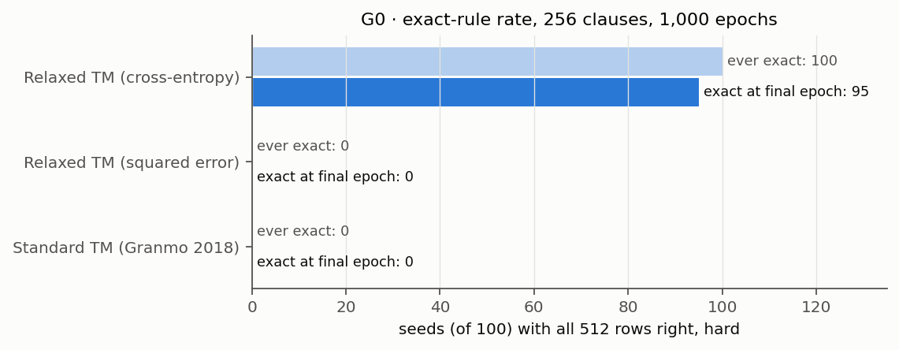
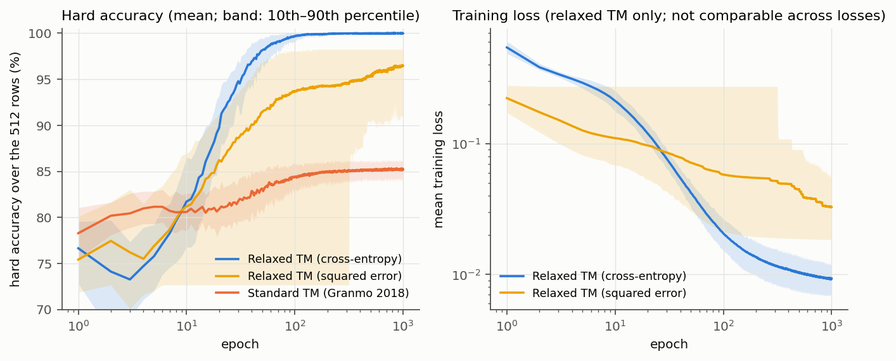
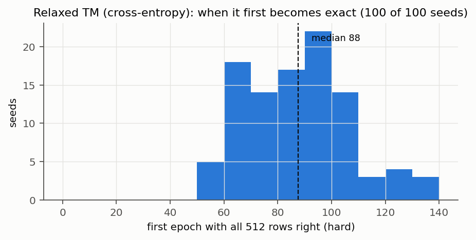
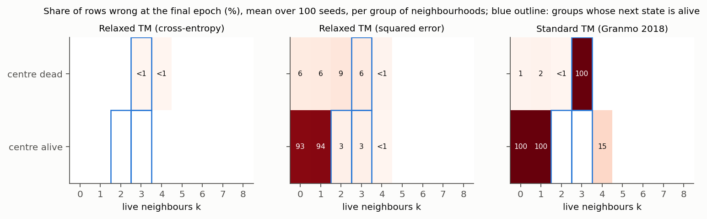
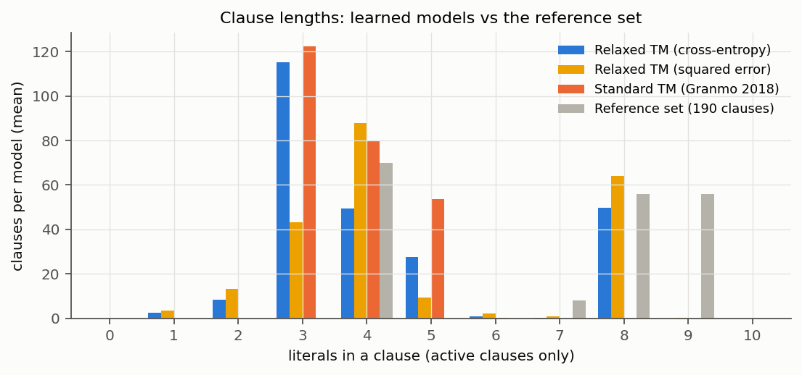

# G0 — Learn the Game of Life rule

Can a relaxed TM learn Conway's Game of Life exactly, and how does it compare
with the standard TM on the same data? Plan: [PLAN.md](../PLAN.md), sections
4 and 5. Run on 2026-11-08 on the Mac, branch `relaxed-tm`.

**Result:** the relaxed TM learns the rule exactly; the standard TM does not.
All accuracies are hard (after rounding to 0/1 logic), over the 512 rows.

| | Exact at final epoch | Ever exact | Hard accuracy (mean ± 95% CI) | Median epochs to exact |
| --- | --- | --- | --- | --- |
| Relaxed TM, cross-entropy | **95 / 100** | **100 / 100** | 99.98% ± 0.02 | 88 |
| Relaxed TM, squared error | 0 / 100 | 0 / 100 | 96.48% ± 0.95 | — |
| Standard TM (Granmo 2018) | 0 / 100 | 0 / 100 | 85.21% ± 0.15 | — |

- **Relaxed TM (cross-entropy):** every seed gets all 512 rows right at some
  point, after 50–150 epochs. 95 are still exact at the final epoch; the other
  5 have 1 wrong row (one has 4), from late flickering (below).
- **Standard TM:** never learns births. In every seed, all 56 rows "dead cell,
  exactly 3 live neighbours" are wrong, and lonely live cells (0 or 1
  neighbours) are kept alive. No setting of T or s changed this.
- **Squared error:** gets close (about 18 wrong rows) but is never exact. It
  used the settings tuned for cross-entropy, so this shows it fails at those
  settings, not that it cannot work.



## Setup

| Part | Setting |
| --- | --- |
| Data | All 512 neighbourhoods (9 bits, row by row, centre at index 4) → next state; 140 alive, 372 dead. Training and evaluation use the same 512 rows |
| Epoch | One pass over the 512 rows in a new random order |
| Relaxed TM | `RelaxedTM`, 256 clauses (128 +, 128 −), learned threshold b, Adam, mini-batches of 32 (16 updates per epoch), 1,000 epochs |
| Standard TM | Granmo's 2018 Multi-Class TM (`granmo2018/`), 2 classes (dead, alive), 256 clauses in total = 128 per class, 100 states per action, 1,000 epochs. His code has no single-output form |
| Reported model | The model after the final epoch (no picking the best epoch) |
| Seeds | Tuning: 1000–1019; reported runs: 0–99 |
| Exact | All 512 rows right, hard |

## Tuning

Settings are chosen by the exact-rule rate on the tuning seeds; ties go to the
setting that becomes exact after fewer epochs.

### Relaxed TM

**First pass** (start mean × τ × learning rate = 2 × 5 × 2): only one of 20
settings learned the rule.

| Start | τ | lr 0.01 | lr 0.05 |
| --- | --- | --- | --- |
| −3 | 1 | 0 / 20 (47.1%) | 0 / 20 (65.1%) |
| −3 | 3 | 0 / 20 (66.5%) | 0 / 20 (65.9%) |
| −3 | 10 | 0 / 20 (83.4%) | 0 / 20 (81.4%) |
| −3 | 30 | 0 / 20 (84.7%) | 0 / 20 (84.5%) |
| −3 | 100 | 0 / 20 (70.7%) | 0 / 20 (72.3%) |
| −1.5 | 1 | 0 / 20 (72.9%) | **18 / 20** (99.98%) |
| −1.5 | 3 | 0 / 20 (83.8%) | 0 / 20 (96.2%) |
| −1.5 | 10 | 0 / 20 (80.8%) | 0 / 20 (80.8%) |
| −1.5 | 30 | 0 / 20 (85.4%) | 0 / 20 (83.9%) |
| −1.5 | 100 | 0 / 20 (70.7%) | 0 / 20 (72.3%) |

Exact seeds at the final epoch, with the mean hard accuracy in brackets. At
τ = 100 the models stay near "always dead" (72.7%).

The one working setting was at a corner of the grid (smallest τ, largest
learning rate), and its seeds flickered between 512 and 511 rows right; none
stayed exact. **Second pass** around that corner (start × τ × learning rate =
2 × 3 × 3):

| Start | τ | lr 0.05 | lr 0.1 | lr 0.2 |
| --- | --- | --- | --- | --- |
| −1.5 | 0.3 | 0 / 20 | 5 / 20 | 20 / 20 (610 ep., 99%) |
| −1.5 | 0.5 | 14 / 20 | 20 / 20 (498 ep., 100%) | 20 / 20 (272 ep., 98%) |
| −1.5 | 1 | 18 / 20 | 20 / 20 (263 ep., 100%) | 19 / 20 |
| −0.5 | 0.3 | 3 / 20 | 20 / 20 (557 ep., 96%) | 19 / 20 |
| −0.5 | 0.5 | 11 / 20 | 19 / 20 | **20 / 20 (78 ep., 98%)** |
| −0.5 | 1 | 14 / 20 | 17 / 20 | 13 / 20 |

For settings with 20 / 20: median epochs to exact, and the share of the last
100 epochs at which the model was exact.

**Chosen: start −0.5, τ = 0.5, learning rate 0.2.** With τ ≤ 1 and a learning
rate of 0.1–0.2 nearly every setting works; a larger learning rate made the
models settle *better*, not worse. The second pass was not extended further:
the chosen setting is exact in 20 of 20 seeds after a median of 78 epochs.

### Standard TM

Two passes, 20 seeds each, never exact at any setting:

| | s = 3 | s = 5 | s = 10 | s = 20 | s = 40 |
| --- | --- | --- | --- | --- | --- |
| T = 10 | 82.5% | 82.6% | 83.1% | | |
| T = 30 | 79.5% | 81.5% | 81.3% | | |
| T = 100 | 82.1% | 83.8% | **85.2%** | 84.3% | 84.1% |
| T = 300 | | | 84.5% | 84.9% | 84.2% |
| T = 1000 | | | 84.8% | 84.8% | 84.6% |

Mean hard accuracy; exact in 0 of 20 seeds in every cell, and never exact at
any epoch. **Chosen: T = 100, s = 10.**

## Learning curves



- **Relaxed TM (cross-entropy):** about 80% after 10 epochs, above 99% after
  about 60, exact after 50–150. Loss falls from 0.54 to 0.021 at epoch 100
  and 0.0093 at epoch 1,000. Soft accuracy is 100% in every seed; the
  soft–hard gap is 0.02 points, and 1.7% of literals are still undecided at the
  end.
- **Standard TM:** rises slowly from 78% to 85% and stays there. Its best
  epoch in any seed is 87.3%.
- **Squared error:** improves until the end but more slowly, and some seeds
  stay at "always dead" for hundreds of epochs (the wide band); one seed is
  still there at epoch 1,000.



**Late flickering.** After becoming exact, a model is exact in 97% of the last
100 epochs on average. The 5 seeds that end non-exact were exact in 19–99% of
their last 100 epochs: a row near the threshold (always a birth row, one
seed also a row with 4 neighbours) switches back and forth. Because Granmo's
protocol reports the final epoch, these count as not exact.

## Which rows are wrong



- **Standard TM:** all births (dead, k = 3) wrong; all live cells with
  k = 0 or 1 kept alive; 15% of live cells with k = 4 kept alive. Its rule is
  close to "the centre stays alive unless crowded; nothing is born". It leans
  on the centre bit and never learns to count exactly 3.
- **Squared error:** mostly lonely live cells kept alive (93–94% of k = 0, 1),
  and some births missed. The seed that predicts dead everywhere gets all 140
  alive rows wrong.

The standard TM's conversion to our hard model predicts exactly like Granmo's
own code in all 100 runs, so this is not a conversion error.

## Learned clauses

| Per model (mean over 100 seeds) | Relaxed, cross-entropy | Relaxed, squared error | Standard TM (both banks) | Reference set |
| --- | --- | --- | --- | --- |
| Clauses | 256 | 256 | 256 | 190 |
| Active (non-empty, not contradictory) | 254.1 | 224.3 | 256 | 190 |
| Contradictory (never fire) | 1.9 | 30.6 | 0 | 0 |
| Distinct | 201.0 | 162.8 | 221.9 | 190 |
| Duplicate share | 21% | 27% | 13% | 0% |
| Pure | 23% | 60% | 0% | 100% |
| Literals per clause | 4.4 | 4.8 | 3.7 | 6.8 |
| Included literals | 1,106 | 1,089 | 956 | 1,288 |

"Pure": a clause that fires only on rows whose next state is the one it votes
for. In the reference set every clause is pure ("any clause fires" style).



**The relaxed TM mixes two styles.**

- **Births are mostly learned as exact rules.** On average 36 of the 56
  reference clauses "exactly 3 live neighbours" are learned exactly (26–44
  per seed), e.g. `+ : NW ∧ N ∧ ¬NE ∧ W ∧ ¬E ∧ ¬SW ∧ ¬S ∧ ¬SE`. These are
  the 8-literal clauses in the figure.
- **Everything else is counted with votes.** None of the 28 "centre alive,
  exactly 2" clauses is learned, and only 7 of the 70 "4 or more" clauses.
  Instead, most clauses are short (3 literals) and impure, and are added up
  against the threshold (b ≈ 1.9). Examples from seed 0: `+ : N`,
  `+ : NW ∧ W ∧ ¬E`, `+ : C ∧ E ∧ ¬S ∧ ¬SE`. Positive clauses: 5.6 literals
  and 39% pure on average; negative clauses: 3.1 literals and 7% pure.
- **Duplicates:** 21% of active clauses are copies, more on the negative side
  (89 distinct of 128) than the positive (112 of 128).

The standard TM has no pure clauses and none of the reference clauses; its
clauses are short (3–5 literals), and it has no 8-literal clauses, which the
"exactly 3" births need in the "any clause fires" style.

Squared error learns more reference clauses (42 "exactly 3", 44 "4 or more")
and more pure clauses, but wastes about 31 clauses as contradictory and never
gets every row.

## Comments

- **The relaxed TM can represent Game of Life exactly, and finds it reliably.**
  100 of 100 seeds, in under 150 epochs, with 256 clauses and no hand-built
  structure. DiffLogic CA reports one seed with a hand-wired first layer.
- **The standard TM's failure is consistent but tested on one implementation.**
  14 settings, 20–100 seeds each, always the same shortcut. Before stating it
  in general, check Granmo's newer `tmu` library on the same table.
- **Counting vs exact rules.** The relaxed TM uses fewer than half of its
  clauses as exact rules; the rest count. The 190-clause reference is
  therefore not the number of clauses it needs: G1 measures that directly.
- **τ matters most.** With τ ≥ 3 nothing worked; with τ ≤ 1 nearly
  everything did. With 256 clauses, a small τ means one or two clause votes
  already move the output a lot, which may be why it works; not tested.

**Caveats.** One clause count (256). Training and evaluation on the same 512
rows: this shows the rule can be represented, not that it generalises (G2).
Squared error was not tuned separately.

## Reproduce

```bash
python -m experiments.relaxed_tm.game_of_life.run_g0 --mode tune-relaxed --workers 8
python -m experiments.relaxed_tm.game_of_life.run_g0 --mode tune-relaxed --workers 8 \
  --init-means=-1.5,-0.5 --taus 0.3,0.5,1 --lrs 0.05,0.1,0.2 --out g0_tune_relaxed_2.json
python -m experiments.relaxed_tm.game_of_life.run_g0 --mode tune-standard --workers 8
python -m experiments.relaxed_tm.game_of_life.run_g0 --mode tune-standard --workers 8 \
  --Ts 100,300,1000 --ss 10,20,40 --out g0_tune_standard_2.json
python -m experiments.relaxed_tm.game_of_life.run_g0 --mode relaxed --workers 8 --tune-file g0_tune_relaxed_2.json
python -m experiments.relaxed_tm.game_of_life.run_g0 --mode relaxed --loss squared --workers 8 --tune-file g0_tune_relaxed_2.json
python -m experiments.relaxed_tm.game_of_life.run_g0 --mode standard --workers 8 --tune-file g0_tune_standard_2.json
python -m experiments.relaxed_tm.game_of_life.plot_g0
```

Times on the Mac with 8 workers: relaxed tuning passes 8–9 min each, standard
tuning passes 10–13 min each, relaxed main runs about 2.5 min (about 10 s per
run), standard main run about 7 min (about 29 s per run).
