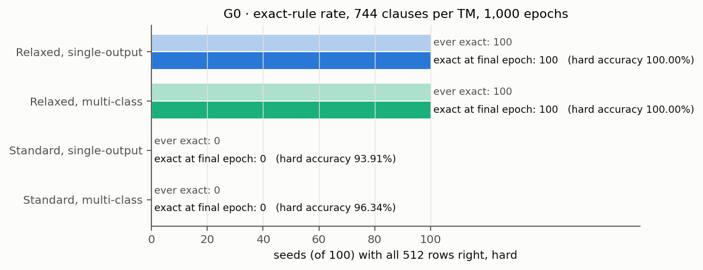
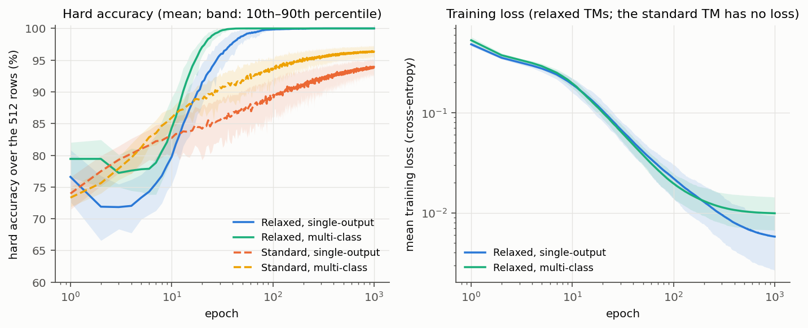
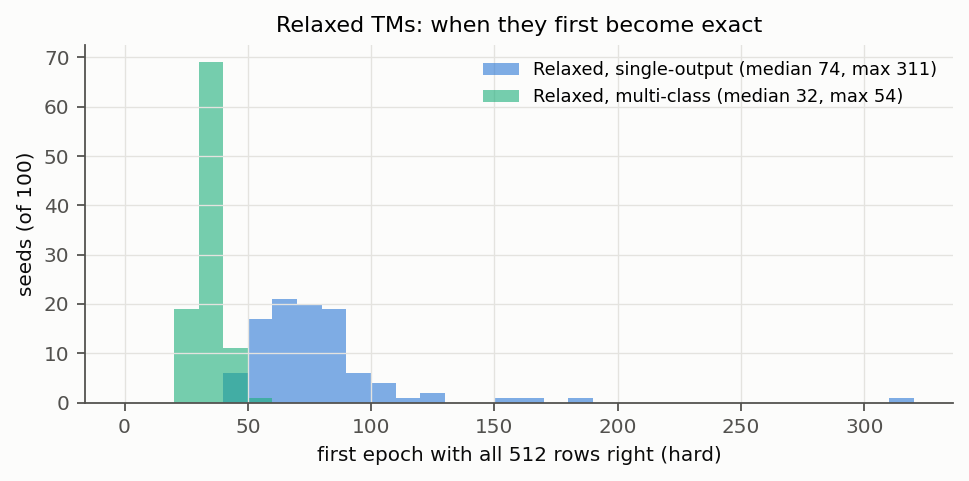
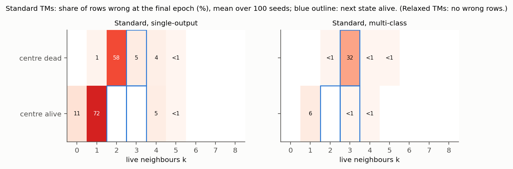
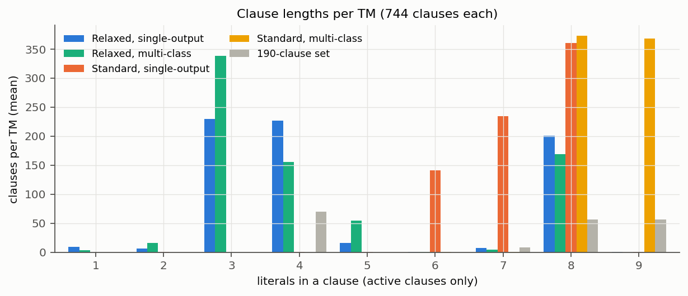

# G0 — Architectures at 744 clauses per TM

Can a relaxed TM learn Conway's Game of Life exactly, and how does it compare
with the standard TM in the same architecture and with the same clauses per
TM? Plan: [PLAN.md](../PLAN.md), sections 3–6. Run on 2026-11-08/09 on the
Mac (8 workers), branch `relaxed-tm`. All grids and the selection rule were
fixed in the plan before any run; an earlier version of G0 is archived in
[../archive/g0_v1_2026-11-08/](../archive/g0_v1_2026-11-08/) and was not used
for any choice here.

**Result:** both relaxed TMs learn the rule exactly in every seed; neither
standard TM does in any seed. All accuracies are hard (after rounding to 0/1
logic), over the 512 rows.

| Model | Exact at final epoch | Ever exact | Hard accuracy (mean ± 95% CI) | Median epochs to exact (max) |
| --- | --- | --- | --- | --- |
| Relaxed, single-output | **100 / 100** | 100 / 100 | 100% ± 0 | 74 (311) |
| Relaxed, multi-class | **100 / 100** | 100 / 100 | 100% ± 0 | 32 (54) |
| Standard, single-output | 0 / 100 | 0 / 100 | 93.91% ± 0.18 | — (best epoch of any seed: 97.1%) |
| Standard, multi-class | 0 / 100 | 0 / 100 | 96.34% ± 0.14 | — (best epoch of any seed: 98.8%) |



- **Relaxed TMs:** exact in 100 of 100 seeds, and still exact in every one of
  the last 100 epochs. No rounding loss: soft accuracy is also 100% and the
  soft–hard gap is 0. The multi-class form is exact sooner (every seed by
  epoch 54).
- **Standard TMs:** with their best settings (T and s tuned, one extension
  pass, boost tried) they reach 94–96% and never get all rows right at any
  epoch. Their clauses are long and pure, close to a lookup table that never
  gets completed (below).

## Setup

| Part | Setting |
| --- | --- |
| Data | All 512 neighbourhoods (9 bits, row by row, centre at index 4) → next state; 140 alive, 372 dead. Training and evaluation on the same 512 rows |
| Epoch | One pass over the 512 rows in a new random order; 1,000 epochs; the model after the final epoch is reported |
| Clauses per TM | 744 (372 +, 372 −), enough for a full lookup table in both architectures (PLAN.md section 3). Multi-class: one TM per class, 1,488 clauses in total |
| Relaxed, single-output | `RelaxedTM`, output sigmoid(s/τ), cross-entropy, threshold b = 0; alive iff hard vote sum ≥ 0 |
| Relaxed, multi-class | `MultiClassRelaxedTM`, 2 classes [dead, alive], softmax cross-entropy over s/τ, no threshold; larger hard vote sum wins, ties → dead |
| Relaxed, training | Adam, mini-batches of 32 (16 updates per epoch) |
| Standard, single-output | Granmo's 2018 `TsetlinMachine.pyx` (cair/TsetlinMachine, commit 3cb8c89); alive iff vote sum ≥ 0; empty clauses vote, as in his code |
| Standard, multi-class | Granmo's 2018 `MultiClassTsetlinMachine.pyx` (same commit), 2 classes; ties → dead, as in his code |
| Standard, both | 100 states per action, no boost (his single-output TM has none) |
| Seeds | Tuning 1000–1019; reported runs 0–99 |
| Exact | All 512 rows right, hard |

For both standard TMs, our converted hard model predicts exactly like
Granmo's own code in all 100 runs.

## Tuning

Same procedure for all four: the grid of PLAN.md section 5, 20 tuning seeds,
the setting with the most exact seeds wins (ties: fewer median epochs to
exact, then higher mean hard accuracy). Every chosen setting lay on a grid
edge, so each model got the one extension pass fixed in the plan (one step
beyond that edge, on that axis).

| Model | Grid (first pass + extension) | Chosen | On the tuning seeds |
| --- | --- | --- | --- |
| Relaxed, single-output | start {−3, −1.5, −0.5, **0**} × τ {0.3, 1, 3, 10} × lr {0.01, 0.05, 0.2, **0.5**} | start 0, τ 1, lr 0.2 | 20 / 20 exact, median 58 epochs |
| Relaxed, multi-class | same | start −0.5, τ 3, lr 0.2 | 20 / 20 exact, median 34 epochs |
| Standard, single-output | T {10, 30, 100, 300} × s {3, 10, 30, 100, **300**} | T 30, s 100 | 0 / 20 exact, 94.0% |
| Standard, multi-class | same | T 300, s 300 | 0 / 20 exact, 96.6% |

Bold: values of the extension pass. The extension values were only crossed
with the other axes' original values.

### Relaxed TMs

Exact seeds (of 20) per setting; for settings with at least one exact seed,
the median epochs to exact in brackets; otherwise the mean hard accuracy.

| Start | τ | Single: lr 0.01 | 0.05 | 0.2 | 0.5 | Multi: lr 0.01 | 0.05 | 0.2 | 0.5 |
| --- | --- | --- | --- | --- | --- | --- | --- | --- | --- |
| −3 | any | 0 (32–64%) | 0 (33–64%) | 0 (43–64%) | 0 (49–63%) | 0 (30–61%) | 0 (33–66%) | 0 (41–53%) | 0 (49–62%) |
| −1.5 | 0.3 | 0 (57%) | 0 (64%) | 0 (69%) | **17** (374) | 0 (55%) | 0 (62%) | 0 (62%) | **14** (169) |
| −1.5 | 1 | 0 (66%) | 0 (66%) | **10** (750) | **7** (272) | 0 (66%) | 0 (66%) | **6** (776) | **18** (79) |
| −1.5 | 3 | 0 (66%) | 0 (66%) | **17** (377) | 0 (94%) | 0 (67%) | 0 (66%) | **19** (375) | **13** (153) |
| −1.5 | 10 | 0 (64%) | 0 (64%) | 0 (92%) | 0 (88%) | 0 (66%) | 0 (66%) | **1** (585) | 0 (93%) |
| −0.5 | 0.3 | 0 (64%) | 0 (66%) | **3** (888) | **3** (742) | 0 (58%) | 0 (64%) | 0 (73%) | **14** (384) |
| −0.5 | 1 | 0 (66%) | 0 (72%) | **20** (83) | 0 (97%) | 0 (66%) | 0 (69%) | **20** (343) | **13** (466) |
| −0.5 | 3 | 0 (65%) | 0 (86%) | **10** (126) | 0 (94%) | 0 (66%) | 0 (84%) | **20** (34) | **2** (442) |
| −0.5 | 10 | 0 (64%) | 0 (71%) | 0 (92%) | 0 (84%) | 0 (64%) | 0 (75%) | 0 (94%) | 0 (90%) |
| 0 | 0.3 | 0 (65%) | 0 (66%) | **15** (684) | | 0 (63%) | 0 (66%) | 0 (94%) | |
| 0 | 1 | 0 (66%) | **16** (544) | **20** (58) | | 0 (66%) | 0 (73%) | **20** (52) | |
| 0 | 3 | 0 (66%) | **2** (545) | 0 (96%) | | 0 (66%) | **20** (244) | **20** (42) | |
| 0 | 10 | 0 (64%) | 0 (91%) | 0 (92%) | | 0 (64%) | 0 (93%) | 0 (93%) | |

- Only a high learning rate (0.2–0.5) and a start near the boundary (−1.5 to
  0) work; a far start (−3) never does. τ must be between 0.3 and 3.
- Many settings stay at 64–66%, close to "always dead" (72.7%) or worse:
  the hard model gets stuck early.

### Standard TMs

Mean hard accuracy on the 20 tuning seeds; exact in 0 seeds in every cell.

| T | Single: s 3 | 10 | 30 | 100 | 300 | Multi: s 3 | 10 | 30 | 100 | 300 |
| --- | --- | --- | --- | --- | --- | --- | --- | --- | --- | --- |
| 10 | 80.2% | 91.3% | 91.7% | 92.1% | 85.7% | 82.1% | 92.9% | 91.9% | 93.3% | 95.5% |
| 30 | 83.4% | 89.8% | 89.6% | **94.0%** | 86.2% | 86.0% | 88.8% | 87.8% | 95.6% | 96.0% |
| 100 | 80.7% | 83.0% | 83.7% | 92.4% | 84.9% | 80.4% | 81.7% | 86.1% | 96.4% | 96.1% |
| 300 | 81.0% | 84.7% | 82.6% | 91.1% | 85.1% | 81.6% | 86.1% | 85.1% | 96.4% | **96.6%** |

- **s matters most, T little.** Larger s gives longer, more specific clauses
  (1.5 literals at s = 3, 7.3–8.5 at s = 100–300).
- Single-output peaks at s = 100 and drops at s = 300. Multi-class is flat
  from s = 100 to 300; its chosen setting is again on the edge, but the plan
  allows only one extension, and it changes by tenths of a point.

## Learning curves



- **Relaxed TMs** rise steeply between epochs 10 and 40 and reach 100%.
  Cross-entropy falls to about 0.006 (single-output) and 0.010 (multi-class)
  by epoch 1,000.
- **Standard TMs** rise slowly and are still creeping up at epoch 1,000:
  single-output 93.3% at epoch 500 → 93.9% at 1,000; multi-class 96.1% →
  96.3%. More epochs would add a little, but at this rate not the 20–30
  missing rows.



## Which rows the standard TMs get wrong



- **Single-output (about 31 wrong rows):** it predicts alive for dead cells
  with 2 neighbours (58% of those 28 rows) and keeps lonely live cells
  alive (72% of k = 1, 11% of k = 0); 5% of births are missed.
- **Multi-class (about 19 wrong rows):** almost only births: 32% of the 56
  rows "dead cell, exactly 3 neighbours" are wrong in every seed; 6% of
  lonely live cells (k = 1) are kept alive.

## Learned clauses

Per model, mean over the 100 seeds. For the multi-class models, the two TMs
are combined: a clause is identified by its literals and the class it votes
for, so the same clause in both TMs voting for the same class counts as a
duplicate.

| | Relaxed, single | Relaxed, multi | Standard, single | Standard, multi | 190-clause set |
| --- | --- | --- | --- | --- | --- |
| Clauses | 744 | 1,488 | 744 | 1,488 | 190 |
| Active (non-empty, not contradictory) | 695 | 1,483 | 736 | 1,481 | 190 |
| Contradictory (never fire) | 49 | 5 | 8 | 7 | 0 |
| Distinct | 360 | 574 | 523 | 681 | 190 |
| Duplicate share | 48% | 61% | 29% | 54% | 0% |
| Distinct clauses in both TMs (multi) | — | 176 | — | 174 | — |
| Pure | 47% | 26% | 98% | 100% | 100% |
| Literals per clause | 4.8 | 4.5 | 7.3 | 8.5 | 6.8 |
| Included literals | 3,357 | 6,656 | 5,369 | 12,586 | 1,288 |

"Pure": a clause that fires only on rows whose next state is the one it votes
for. Clauses of the 190-clause set learned exactly (mean per model):

| Case of the 190-clause set | Relaxed, single | Relaxed, multi | Standard, single | Standard, multi |
| --- | --- | --- | --- | --- |
| + exactly 3 live neighbours (56, 8 literals) | **52.4** | **55.4** | 27.2 | 0 |
| + centre alive, exactly 2 (28, 9 literals) | 0 | 0 | 0 | **28.0** |
| − 4 or more live neighbours (70, 4 literals) | **44.1** | 16.5 | 0 | 0 |
| − at most 1 live neighbour (8, 7 literals) | 0 | 0 | 2.4 | 0 |
| − centre dead, exactly 2 (28, 9 literals) | 0 | 0 | 0 | 0 |



**Relaxed TMs: exact rules for births, counting for the rest.**

- Nearly all 56 "exactly 3" birth clauses are learned exactly, often several
  times, e.g. `+ : ¬NW ∧ N ∧ ¬NE ∧ W ∧ ¬E ∧ SW ∧ ¬S ∧ ¬SE (×7)` (seed 0).
  These are the 8-literal clauses in the figure.
- The single-output TM also learns 44 of the 70 "4 or more neighbours"
  clauses (4 literals).
- The rest are short (3–4 literals), mostly impure clauses whose votes add
  up: none of the 28 "centre alive, exactly 2" survival clauses is learned,
  yet survival is right in every seed. Positive clauses: 61% pure; negative:
  35% (single-output).
- About half of all clauses are copies (48–61%); the single-output TM also
  wastes about 49 contradictory clauses.

**Standard TMs: long, pure clauses, close to a lookup table.**

- Almost every clause is pure, and the clauses are long: 6–8 literals
  (single-output), and only 8 or 9 literals (multi-class). A 9-literal clause
  fires on exactly one row, so the multi-class TM is building a lookup
  table, one row at a time.
- That table is never completed. The multi-class TM learns all 28 survival
  rows exactly (9 literals) but none of the 8-literal birth clauses, and
  misses a third of the birth rows; it does not find short clauses or
  counting.

## Ablations

One change at a time from each model's chosen setting, seeds 0–99.

| Model | Change | Exact at final epoch | Hard accuracy | Median epochs to exact (max) | Compared with the main run |
| --- | --- | --- | --- | --- | --- |
| Relaxed, single | Learned threshold b | 100 / 100 | 100% | **41 (60)** | Faster (main: 74, max 311); b settles at about 5.7 |
| Relaxed, multi | Learned threshold per class | 100 / 100 | 100% | 33 (46) | No real change (main: 32); thresholds −4.4 / +4.4 |
| Relaxed, single | Squared error | **1 / 100** | 98.26% | — | Much worse: about 9 wrong rows |
| Relaxed, multi | Squared error | **5 / 100** | 98.33% | — | Much worse: about 9 wrong rows |
| Standard, multi | Boost (Granmo's April 2018 code) | 0 / 100 | 96.35% | — | No change (main: 96.34%); still misses about 18 births |

- **Learned threshold.** With b ≈ 5.7, a row on which no clause fires comes
  out dead, the common class (PLAN.md section 3); the single-output TM then
  becomes exact twice as fast and never needs more than 60 epochs. In the
  multi-class TM only the difference of the two thresholds matters, and it
  already has dead as its default (ties), so nothing changes.
- **Squared error.** Both relaxed TMs then keep lonely live cells alive
  (about 8 of the 9 rows "centre alive, 0 or 1 neighbours"). The settings
  were tuned for cross-entropy, so this shows the loss matters at these
  settings, not that squared error cannot work.
- **Boost** makes no difference to the standard multi-class TM.

## Comments

- **The relaxed TM learns Game of Life exactly, in both architectures and
  every seed;** with the same clauses per TM and its own full tuning, the
  standard TM does not, in either architecture. DiffLogic CA reports one
  exact seed with a hand-wired first layer; the relaxed TM needs no
  hand-built structure.
- **Why the standard TM struggles (interpretation, not tested).** Its
  feedback grows clauses from the patterns it sees often; s sets how specific
  they become. Game of Life births are many rare patterns (each covers 2 of
  the 140 alive rows) next to rows of the other class that differ by one
  bit. With small s its clauses are too general; with large s they become
  one-row clauses, and the rare rows are never all covered. The relaxed TM
  instead mixes exact birth clauses with short counting clauses.
- **The standard TMs are still improving slowly at epoch 1,000**
  (+0.3 points over the last 500 epochs). A much longer run would show
  whether they eventually get there; at this rate it would take far more
  than 1,000 epochs.
- **Many duplicates.** At 744 clauses per TM, half of the relaxed TMs'
  clauses are copies, and the birth clauses are repeated up to 7 times: far
  more clauses than needed. G1 measures how few are enough.
- **Size.** The hardened relaxed single-output TM has 695 active clauses and
  3,357 included literals; DiffLogic CA reports 336 active gates. Different
  units, and at 744 clauses most of the model is duplicates; G1 gives the
  fair size comparison.

**Caveats.** Training and evaluation on the same 512 rows: the models
represent the rule; whether they generalise to unseen neighbourhoods is G2.
One clause count (744). The standard TMs were run for 1,000 epochs like the
relaxed TMs, and were still improving slowly. Squared error was not tuned
separately.

## Reproduce

```bash
for m in relaxed standard; do for a in single multi; do
  python -m experiments.relaxed_tm.game_of_life.run_g0 --model $m --arch $a --mode tune --workers 8
  python -m experiments.relaxed_tm.game_of_life.run_g0 --model $m --arch $a --mode extend --workers 8
  python -m experiments.relaxed_tm.game_of_life.run_g0 --model $m --arch $a --mode main --workers 8
done; done
python -m experiments.relaxed_tm.game_of_life.run_g0 --mode ablation --workers 8 --model relaxed --arch single --ablation bias
python -m experiments.relaxed_tm.game_of_life.run_g0 --mode ablation --workers 8 --model relaxed --arch multi --ablation bias
python -m experiments.relaxed_tm.game_of_life.run_g0 --mode ablation --workers 8 --model relaxed --arch single --ablation squared
python -m experiments.relaxed_tm.game_of_life.run_g0 --mode ablation --workers 8 --model relaxed --arch multi --ablation squared
python -m experiments.relaxed_tm.game_of_life.run_g0 --mode ablation --workers 8 --model standard --arch multi --ablation boost
python -m experiments.relaxed_tm.game_of_life.plot_g0
```

Times on the Mac with 8 workers: tuning 26 / 48 / 50 / 108 min (relaxed
single, relaxed multi, standard single, standard multi); extension 19 / 33 /
10 / 19 min; main runs 4 / 7 / 12 / 23 min (about 17, 32, 55 and 110 s per
run); ablations about 4–25 min each.
